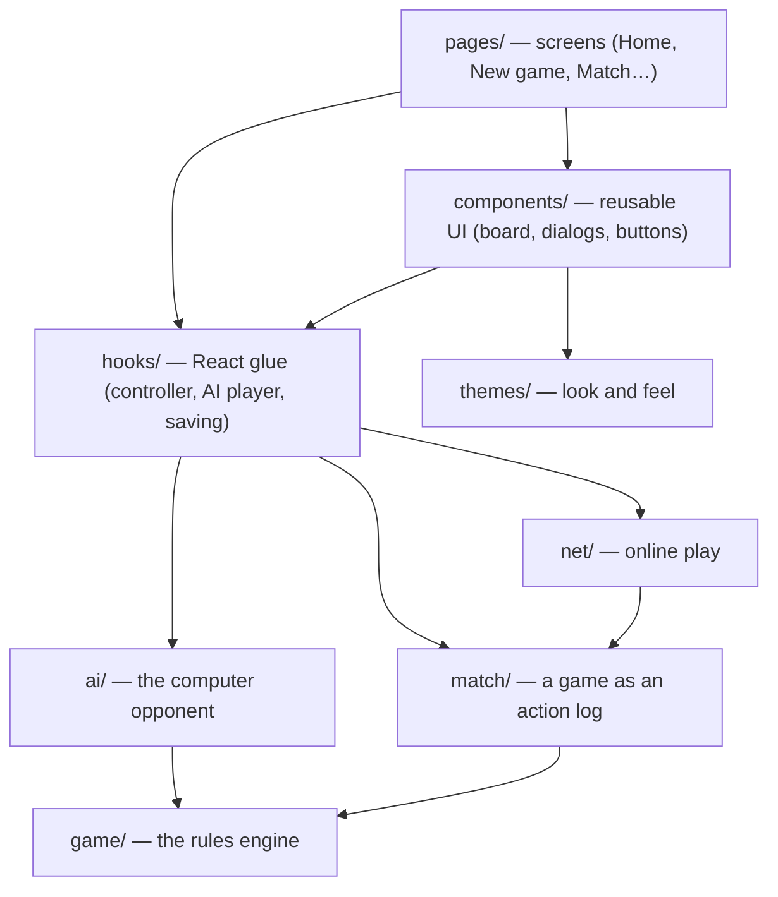
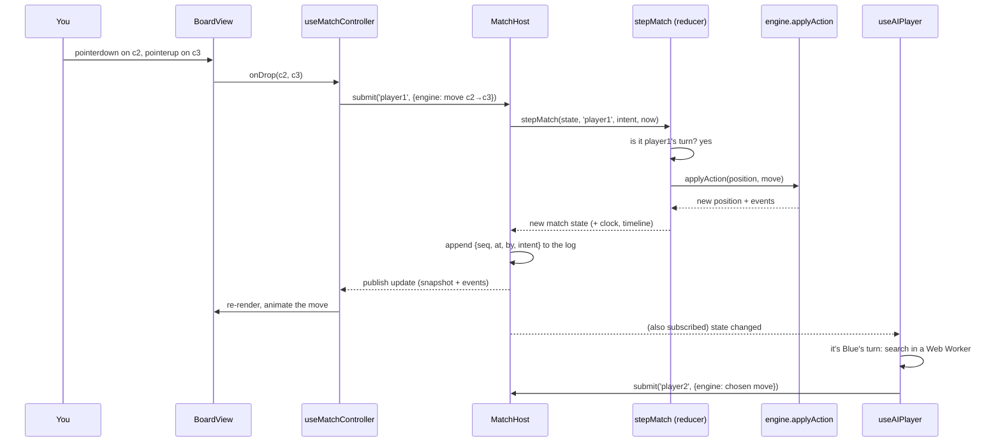
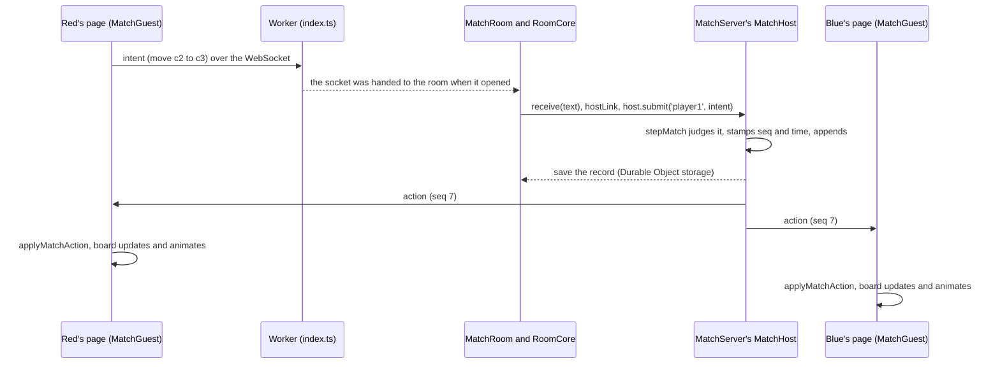

# Open Dam: a guided walkthrough

This is my attempt to really understand this codebase. Open Dam means a lot to
me, so it was not enough for it to work: I wanted to know every part of it. By
the end you should be able to explain what every part of the code does, why it
is built that way, and where to make any change you want. Read it top to bottom
once; afterwards use it as a reference.

**How to read it.** Each part builds on the one before. Part 1 is the big
picture, Part 2 follows one click through the whole system, Parts 3–9 go layer
by layer, Part 10 covers the tools, Part 11 is recipes for common changes, and
Part 12 has exercises to check your understanding. File references look like
`src/game/engine.ts` and are worth opening alongside the text.

## What changed recently

The latest round of work (November 2026), newest first. Each line points to
where it is explained.

- **A spoken warning when your clock runs low.** Under 20 seconds, a screen
  reader now hears it once per turn (Part 9, "The board and accessibility").
- **HSTS** is sent for a year, without `preload` (Part 6, "The server's
  defences").
- **A weekly backup of the accounts database** to an R2 bucket, written but
  off until the bucket exists (Part 6, "Accounts", and OPERATIONS.md).
- **The page keeps its top bar while loading** instead of going blank
  (Part 8, "The installed app and offline play").
- **An About page**, `/about`, on Dam in The Gambia (Part 9, the routes
  table).
- **Vibration** on phones with every move, capture and call, with a switch in
  Settings (Part 8, "Sound").
- **A local clock pauses while the page is hidden**, not only when it closes
  (Part 5, "Clocks").
- **Home counts moves like the result screen** (Part 3, "Notation").
- **Two tabs can no longer overwrite each other's game** (Part 5, "Two tabs,
  one slot"), the most serious bug of the round: closing an old tab could undo
  the moves you had just played in another.
- **Two new traces** to read alongside Part 2: the life of an online move and
  the life of a sign-in (Part 6), and a section on the server's defences.

---

## Part 1 — The big picture

### What the program is

A website where you can play Dam, the Gambian board game: against the
computer, against someone on the same device, or online, either a rated game
against a stranger near your strength or a friend you send a link to. Players
can make an account, which keeps their rating, history and settings on every
device, and puts them on the leaderboards. It also teaches the rules and has a
free "analysis" board.

### The layers

The code is a stack of layers. Each layer only uses the layers below it. This
is the single most important structural rule in the project.



| Layer   | Folder                        | Knows about React? | Job                                                                 |
| ------- | ----------------------------- | ------------------ | ------------------------------------------------------------------- |
| Rules   | `src/game`                    | No                 | What is legal; what happens after a move                            |
| AI      | `src/ai`                      | No                 | Choose a move for the computer                                      |
| Match   | `src/match`                   | No                 | A whole game: who plays, the log of actions, offers, clocks, saving |
| Network | `src/net`                     | No                 | Send a match between browsers                                       |
| Hooks   | `src/hooks`                   | Yes                | Connect the pure layers to React components                         |
| UI      | `src/components`, `src/pages` | Yes                | What you see and click                                              |
| Themes  | `src/themes`, `src/styles`    | Partly             | Colours, shapes, motion, sound                                      |

Why this matters: the bottom four layers are **pure TypeScript**. They can be
tested in milliseconds without a browser, they could run on a server
unchanged, and a bug in the UI cannot corrupt the rules.

### Three ideas that explain most of the design

1. **The engine is a pure function.** `applyAction(state, action)` returns a
   new state plus a list of events. It never changes the old state, never
   touches the screen, never reads the clock. (Part 3.)
2. **A game is a log of actions.** The match layer stores the settings, who sits
   where, and every action in order. The board, the move list, the clocks and
   pending offers are all _computed_ by replaying that log. Saving, undo,
   review and online play all come from this one idea. (Part 5.)
3. **Themes are complete visual languages.** A theme supplies colour tokens and
   its own React components for pieces and board decorations, so a theme can
   change shapes, not only colours. (Part 8.)

---

## Part 2 — The life of a click

Let's follow what happens when you play Red against the computer and drag a
piece from c2 to c3. Keep this trace in mind; every later part zooms into one
step of it.



Step by step:

1. **Input.** `src/components/board/BoardView.tsx` receives the pointer events.
   `src/hooks/usePointerDrag.ts` decides whether it was a tap or a drag and
   which square the pointer was released on.
2. **Permission to touch.** Before a drag can even start, the board asks
   `canDragFrom(c2)`. That comes from `useMatchController` and says yes only if
   it is your turn and c2 holds one of _your_ pieces. This is why you can't move
   the computer's pieces.
3. **Intent.** The controller turns the drop into an _intent_,
   `{ type: 'engine', action: { type: 'move', from, to } }`, and submits it to
   the session as `player1`.
4. **Judgement.** `MatchHost.submit` calls `stepMatch` in
   `src/match/reducer.ts`. It checks it's Red's turn, then calls the engine's
   `applyAction`, which checks the rules (orthogonal, forward or sideways, not
   occupied…). If anything fails you get an error string, shown as a toast.
5. **Record.** The host stamps the intent with a sequence number and the time,
   appends it to the log, and computes the new state: new position, clock
   handed to Blue, offers cleared.
6. **Broadcast.** The host notifies its subscribers. React re-renders through
   `useSyncExternalStore`; the controller feeds the engine's events to the
   animation hook; the saving hook writes the record to localStorage.
7. **The computer's turn.** `src/hooks/useAIPlayer.ts` is also subscribed. It
   sees it is Blue's turn and asks `src/ai/client.ts` to search in a Web
   Worker, so the page doesn't freeze. When the answer arrives it submits it
   through exactly the same `submit` call. The computer is just another
   participant.

---

## Part 3 — The rules engine (`src/game`)

### The vocabulary: `types.ts`

Start here, because every other file speaks this language.

- `PlayerId` is `'player1' | 'player2'`. Player 1 starts at the bottom and moves
  up; player 2 starts at the top and moves down. Themes give them names (Red and
  Blue, Black and White, Coral and Sky).
- `Board` is a 2-D array of `PieceData | null`. Row 0 is the **top**.
- `RuleSettings` is board size, start type, the three house rules (promotion
  during a chain, what a call removes, whether stopping a chain is callable), the
  two draw rules, and an optional time control.
- `EngineState` is a complete position: board, side to move, status, the chain
  in progress, the _offenders_ (pieces that passed up a capture and can be
  called), the move list, repetition counts, and the no-capture counter.
- `EngineAction` is everything a player can do: `move`, `end-chain`, `call`,
  `resign`, `agree-draw`, `timeout`.
- `GameEvent` describes what happened (moved, captured, crowned, called…), so the
  UI can animate without comparing boards.

### The geometry: `board.ts` and `moves.ts`

- `board.ts` fixes the direction convention once (`forwardDir`,
  `promotionRow`), builds starting positions (odd boards interlock around an
  empty centre; even boards start in rows with a two-row gap), and serialises
  positions for repetition detection.
- `moves.ts` generates moves. Normal pieces move one step forward, left or
  right; they capture by jumping an adjacent enemy straight across onto the
  empty square beyond. Kings move any distance and may land anywhere past the
  piece they jump. `classifyMove(board, player, from, to)` is how the engine
  turns "from here to there" into a slide, a capture, or a human-readable reason
  it's illegal.

### The state machine: `engine.ts`

This is the heart. Read it in this order:

1. `createInitialState(settings)` — a fresh game.
2. `applyMove(state, from, to)` — the big one. It handles, in order: the chain
   lock (mid-chain you may only continue with the same piece), the special
   first move on odd boards (any piece may go straight into the centre), slides
   (with promotion), and captures (with the three promotion policies and chain
   continuation).
3. `endTurn(...)` — hands the turn over. This is where **offenders** are
   computed: if you could have captured at the start of your turn and didn't,
   your capturing pieces become callable. It also re-finds each offender on
   the board, because the piece that skipped the capture might be the one that
   just moved.
4. `applyCall(state, pieceId?)` — removes an offender. It does **not** end the
   turn: you call, then still move.
5. `declineChain(state)` — stop a chain early; under the default rules the
   piece becomes callable.
6. `evaluateStatus` / `settleStatus` — checked after every change: no pieces
   left → loss; side to move has no legal move and nothing to call → loss; one
   piece each with nothing to capture → draw; threefold repetition → draw; too
   many moves without a capture → draw.
7. `applyAction(state, action)` — a switch that routes any `EngineAction` to the
   functions above. This is the single entry point everything else uses.
8. `legalActions(state)` — every legal action; the AI and tests use it. On
   an odd board's first move that includes every legal jump to the centre,
   not only the two neighbouring steps. Until 2026-10-28 it left those out,
   so the computer never used the special opening.

**Why pure functions?** Because `applyMove` returns a _new_ state and never
modifies the old one, keeping history is trivial (just keep the old states),
and every function can be tested by building a position and checking the
result. Look at `src/game/engine.test.ts`: positions are written as text
(`'..a..'`) using `positionFromAscii` from `position.ts`.

### Notation: `notation.ts`

Squares are named like chess: file letter + rank number, with a1 at Red's
bottom-left. Moves: `c2-c3` (quiet), `c2xc4` (capture), `c2xc4xe4` (chain),
`=K` (crowned), ` ?!` (a capture was passed up), `!c3` (a call).
`toMoveRows` groups the flat move list into numbered pairs for display.
Each chain leg is its own record in `moves` (the first `capture`, then one
`chain` per further jump), so "how many moves" is not `moves.length`:
`turnsPlayed` counts moves and first captures only. The result summary, Home's
"Your game is waiting" card and the server's stored game all use it; Home used
to count every chain leg and call as a move.

### Settings: `settings.ts`

Defaults with the reasoning for each subjective rule, the time controls, the
labels the UI shows, the rules summary for the Learn page, and the matchmaking
compatibility check the lobby uses to pair two seeks.

---

## Part 4 — The computer opponent (`src/ai`)

### How it chooses a move: `search.ts`

The AI uses **negamax with alpha-beta pruning**, the classic game-tree search:

- Look at every move, then every reply, then every reply to that, down to a
  fixed depth.
- At the bottom, score the position with `evaluate`.
- "Negamax" means a score is always from the point of view of the side to move;
  a child's score is negated when the turn passes to the opponent.
- "Alpha-beta" skips branches that cannot change the final decision, which
  makes deep searches affordable.

Things specific to Dam:

- **Chains don't alternate turns, and cost no depth.** A capture that can
  continue keeps the same player on move, so a child's score is only negated if
  the turn actually changed. Each chain leg is searched at the same depth: a
  chain is one decision, and it always ends because every leg removes a piece.
  Without this, a three-leg chain used up three plies of lookahead and the
  engine could not see a sacrifice that sets one up.
- **Calls are taken greedily.** Calling is free material and doesn't use your
  turn, so the search always takes the most valuable call instead of branching.
- **Skipping a capture is not free.** At the bottom of the search
  (quiescence) it keeps looking at captures until things are quiet. The side to
  move may normally "stand pat" there, but in Dam standing pat while a capture
  is on the board means declining it, and the piece gets called. The search
  charges for that (`declineCost`), which is what lets it see the sacrifice
  that says "take this, or lose that piece".
- **Forced replies are looked at deeper**, like check extensions in chess,
  within a per-line budget.
- **Iterative deepening, a transposition table and move ordering.** It
  searches depth 1, then 2, then 3… until the time budget runs out. Positions
  already scored are remembered by a Zobrist hash (`hash.ts`), and moves that
  caused cut-offs before are tried first.

### How it scores a position: `evaluate.ts`

Material (kings are worth more on bigger boards), mobility, advancement
(scaled by the promotion rule), holding your back row, the cost of being
callable, capture threats, king activity, corrections for drawish endings and
running draw counters, and **lone-king technique**.

Four rules decide almost every ending, and the evaluation has to know them:

1. **A last piece is crowned automatically.** Taking the opponent's
   second-to-last piece gives their last one a free crown, so "winning a king"
   can be an even trade.
2. **One piece each with nothing to capture is a draw.** Winning means total
   elimination, so a one-piece lead at the end is usually not enough.
3. **A lone king that can capture must.** If it declines, its last piece is
   called and it loses. So the hunter can force its move: offer a piece where
   every landing square is covered, and it has to take and be taken (the
   kill-or-be-called sacrifice). `loneKingPressure` counts the lone king's safe
   squares, and when a capture is on offer, only its safe landings.
4. **Men cannot hunt.** They never move backward, and the lone king guards
   their whole crowning row; the only safe crowning squares are ones it cannot
   jump, usually corners. `promotionPush` rewards getting a man there. With a
   king, the technique is to take away the lone king's safe squares, ending
   with it in a corner and kings on the two edges that meet there.

### How tiers differ: `difficulty.ts`

Five opponents, named in Wolof, differ in what they _know_, in the order a
person learns it. The names mean the fool, the child, the youngster
(usually a teen), the elder and the master; the app shows each meaning beside the
name.

| Tier      | Depth | Search budget | Pause at least | Shown strength | What it knows                                                                             |
| --------- | ----- | ------------- | -------------- | -------------- | ----------------------------------------------------------------------------------------- |
| **Döff**  | 1     | 0.1 s         | 0.35–0.75 s    | 500            | Counts pieces, looks one move ahead, often forgets to call.                               |
| **Khàlé** | 2     | 0.25 s        | 0.4–0.85 s     | 850            | Sees your reply, but not that a capture it skips will be called.                          |
| **Ndö**   | 4     | 0.6 s         | 0.45–0.95 s    | 1200           | Knows the calling rule cold; reads short exchanges. No deep sacrifices, no endgame plan.  |
| **Màam**  | 10    | 1.2 s         | 0.5–1.1 s      | 1550           | Deep search, every chain, sacrifices that win kings, lone-king hunting. Rare small slips. |
| **Seriñ** | 40    | 2.6 s         | 0.5–1.2 s      | 1900           | Everything, deepest, forced-reply extensions, full technique, no deliberate errors.       |

The numbers come from `DIFFICULTIES` in `src/ai/difficulty.ts`. _Depth_ is the
deepest the iterative deepening may go in plies; the _search budget_
(`timeBudgetMs`) usually stops it first, so Seriñ's "40" really means "as deep
as 2.6 seconds allow". _Pause at least_ (`thinkMs`) is the shortest time
before a move appears, picked at random in that range, so an instant answer
from a weak tier still feels like someone thinking; a search that takes longer
is shown when it finishes. _Shown strength_ is the Elo-style number beside each name on the New
game page; it is a guide, not measured against people.

The weaker tiers make "near miss" mistakes: when they slip, they pick a move
that scored almost as well, the way a person misjudges rather than throws a
piece away. Old tier ids (`novice`, `club`, `expert`, `master`) in saved games
and links map to their successors through `normalizeDifficultyId`.

### The first move: `openings.ts`

On 5×5, 7×7 and 9×9 the first move may send any piece to the empty centre.
The board is packed, so the square that move empties decides the reply,
which is usually forced. The search cannot tell these openings apart: their
consequences come dozens of plies later, and at the root they all score about
even. So the first move comes from an **opening book** instead: Seriñ played
itself from every opening (`npm run openings`), and each opening's score is
(wins − losses) / games for the first player.

The computer does not simply play the best one. `pickOpening` gives each
opening a weight of e^(score / temperature) and picks at random by weight.
Each tier has its own `openingTemperature`: Seriñ's 0.15 almost always picks
one of the top openings but varies between them, while Döff's 2 leans towards
the good ones but plays nearly anything. The pick happens before a tier's
deliberate mistakes, so the temperature alone sets how often it opens badly.

What the games showed on 5×5: emptying your home row (a1) hands over a king on
move one, and emptying b2 lets a piece settle where your own pieces block each
other's jumps; both lost every game. The Learn page's opening puzzle reads its
answers from the same book, so re-measuring updates both.

### Other decisions: `opponent.ts`

Whether to accept an undo (compares the evaluation now against the position the
undo would return to) or a draw (accepts when not clearly ahead).

### Off the main thread: `client.ts` and `search.worker.ts`

The search can take a couple of seconds. Running it on the page's main thread
would freeze clicks and animations, so `searchAsync` sends the position to a
Web Worker (a background thread) and waits for the answer. If workers aren't
available it falls back to running inline.

### Two bugs worth understanding

**Whose score is this?** The old Master once drew Novice six games out of six.
When the search reached a finished game it scored it from the _root player's_
point of view instead of the side to move, so a winning capture that handed the
turn over came back with the wrong sign. Always ask who a negamax score is for.

**Credit, not blame.** The first lone-king term scored the hunter _down_ for
every square the lone king could still reach. Reducing the opponent to one
piece then looked worse than leaving them two, so the engine stopped taking
winning captures and lost twelve games out of twelve to the old engine. It was
found by switching each new feature off in turn. A replayed game then showed a
second mistake: the engine sacrificed a man to win a king without realising the
opponent's last man would be crowned for free, and reached a dead draw with two
men against a king. The term now only adds credit for progress, and only counts
in full when the hunter has a king.

To study a game yourself, `RED=serin BLUE=maam SEED=3 FROM=6 npm run replay`
prints every ply with the board and the engine's score. Find the move where the
score went wrong, then ask which rule the evaluation did not understand.

---

## Part 5 — A game as a log (`src/match`)

### The record

```ts
MatchRecord = {
  format: 'open-dam/match', version: 1,
  config: { id, mode: 'local' | 'online', settings, seats, createdAt },
  actions: [ { seq: 1, at: 1730073600000, by: 'player1', intent: {...} }, ... ]
}
```

`seats` says who plays each side: `human` (this device), `ai` (with a
difficulty), or `remote` (someone elsewhere).

An **intent** is what someone asks for: a board action, an offer (undo or
draw), an answer to an offer, withdrawing an offer, or clock bookkeeping (pause
and resume). An **action** is an intent that was accepted, stamped with its
sequence number, time, and who made it.

### The reducer: `reducer.ts`

`stepMatch(state, by, intent, at)` is the judge. Given the current match state,
who is asking, what they ask, and when, it either refuses with a reason or
returns the next state. It enforces:

- only the side to move can make board moves; you can only resign for yourself;
- only the clock (`system`) can call time, and only when time is really up;
- one undo request and one draw offer per player per turn;
- only the other player can answer an offer; only the offerer can withdraw it;
- playing on declines a pending offer;
- an accepted undo rolls `timeline` back to the requester's last turn.

`replay(record)` runs every action through `stepMatch` from the start. If any
action is refused, the record is invalid and replay throws, which is how
corrupted saves are detected.

`MatchState.timeline` holds every position since the start, which is what makes
reviewing any move possible.

### Clocks: `match/clock.ts`

The clock is never a running timer inside the game. It is arithmetic on action
timestamps: when a turn finishes at time `at`, the mover is charged
`at − since`, gets the increment, and the opponent starts running from `at`.
To show the time "now", `remainingAt(clock, player, now)` subtracts the time
since `since` for the running side. Because everything comes from timestamps
in the log, replaying a saved game reproduces the clocks exactly.

Pause and resume exist for local games: when you close the app, the clock
shouldn't keep eating your time, so the saving hook records a pause, and a
resume when you come back. "Leaving" is the page being _hidden_
(`visibilitychange`), not only closed (`pagehide`): a phone switching to
another app hides the page without closing it, and until 2026-11 a clock
against the computer kept running while you answered a message.

### Sessions: `session.ts`

A session wraps a record and its state so React can watch it:
`getSnapshot()`, `subscribe(listener)`, `submit(by, intent)`. `MatchHost`
is the authoritative kind: it runs `stepMatch`, stamps actions, appends them,
and publishes. Every local game is a `MatchHost`.

### Saving: `storage.ts` and `setup.ts`

- `saveActiveMatch` / `loadActiveMatch` keep the one unfinished game in
  localStorage. Loading **validates** the shape and replays it; anything that
  doesn't replay is discarded rather than trusted.
- `archiveMatch` keeps the last 50 finished games for "Recent games" and review.
- **Two tabs, one slot.** Every tab of the app shares that one active-game
  slot, and each save replaces it whole. Until 2026-11 a tab left open on a
  game could write an older copy back over a newer one: open the game twice,
  play on in one tab, then close the other, and the closing tab's last save
  undid your moves. Worse, a tab whose clock ran out cleared the slot, deleting
  a new game started elsewhere. Now `saveActiveMatch` returns a _stamp_ of what
  it wrote (game id, number of actions, time), `activeMatchStamp` reads the
  slot's current one, and `useMatchPersistence` writes only while the slot
  still holds its own last stamp. When another tab has saved (it hears the
  browser's `storage` event, or notices just before its next write), it stops
  writing for good and the page shows "This game moved on in another tab" with
  a button to open the latest game. This is an _optimistic_ check: no lock,
  just "is it still what I last wrote?", which is enough because
  localStorage calls in one tab run to completion before another tab's can
  change anything we read in between. `src/test/persistence.test.tsx` plays the
  other tab by writing localStorage directly.
- `setup.ts` describes the New Game form's result and its URL form, so the
  Home page's quick-play cards are plain links like
  `/match/new?vs=ndo&size=5` (old ids such as `club` still work).

---

## Part 6 — Online play (`src/net`)

Read `docs/MULTIPLAYER.md` for the full design. In short:

- The **host** owns the log and runs the reducer. Online, the host is the
  match server; in a local game it is the page itself.
- Other devices are **guests** (`MatchGuest`). They send intents and apply the
  actions the host broadcasts. They never decide anything themselves, so two
  devices can never disagree about the game.
- `protocol.ts` lists the messages; a transport moves them. The app uses
  `WebSocketTransport` (`websocket.ts`), which reconnects by itself;
  `transport.ts` has a same-browser `BroadcastChannel` one and an in-memory
  one for tests. `api.ts` is how the browser finds the server and asks it for
  a new game.
- `hostLink.ts` is the host-side "server logic": binding a browser tab to a
  seat, forwarding its intents to the reducer, broadcasting accepted actions,
  and tracking who is online: through heartbeats in a browser host, or
  through open connections on a server (`presence: 'connection'`), so no
  timer keeps a sleeping server awake.
- `server.ts` is everything the server does apart from the network: one
  room per match, both seats remote, the record saved after every action, and
  the server's own clock calling flags. `server.test.ts` plays games through
  it end to end, including a server crash and restart.
- `worker/` puts it on the internet: a Cloudflare Worker that creates matches
  and serves the app, and one Durable Object per match (`room.ts`, logic in
  `roomCore.ts`) that runs `MatchServer` with its own storage. Its sockets
  hibernate between moves; one alarm calls a running clock's flag even with
  nobody connected, retries a report that failed, and cleans up a game nobody
  opens for a month. `npm run server` runs it locally; MULTIPLAYER.md
  ("Sleeping between moves", "One alarm, three deadlines") has the details
  and the deploy steps.
- `matchmaking.ts` is the queue a server pairs players from, and
  `src/match/rating.ts` the Elo arithmetic finished games are rated with
  (through `MatchServer`'s `onFinished`). `lobby.ts` is the matchmaking
  counterpart of `server.ts`: players send a `seek` with the rules they want,
  the lobby looks up their rating itself, runs the queue, makes a game for
  each pairing and answers both with `paired` (match id and seat), after
  which they join that match like invited players.

### Accounts

- `account.ts` is what the browser and the server agree on: the shapes of a
  user, a rating, a game summary and a leaderboard row, the checks for
  usernames and passwords (both sides run them), rating pools, and
  `stretchPassword`, which turns a password into the key the server sees.
- `accountApi.ts` calls the account routes; every call sends the session
  cookie, which only the server can read.
- `accountSync.ts` keeps settings and finished games the same on every device.
  Local storage stays the working copy; `storage` (src/services/storage.ts)
  announces each change with where it came from, `local` or `remote`, so the
  sync sends local changes up and the stores that keep a value in memory
  (theme, sound, preferences, puzzles, Home's recent games) re-read remote
  ones.
- On the server, `worker/accountStore.ts` does the work over SQLite, inside
  the `Accounts` Durable Object (`worker/accounts.ts`). The Worker turns the
  session cookie into an `Identity` and hands it to the match room and the
  lobby with each socket; a seat claimed by an account is that account's
  alone, and a finished game with accounts is reported back to `Accounts`,
  which stores and rates it.
- **The weekly backup** (`worker/backupExport.ts`). Durable Objects keep 30
  days of history, which the admin restore route rolls back to. For anything
  older, or the loss of the account, `AccountStore.exportAll` dumps the
  tables that matter (accounts, ratings, games, synced data, reports, held
  names; not sessions or counters) as one JSON value, and the Worker's
  `scheduled` handler writes it to an R2 bucket as
  `accounts/<date>.json` every Monday at 03:00 UTC, keeping the newest 12.
  It is off until the owner creates the bucket and uncomments two lines in
  `wrangler.jsonc`: with no `BACKUPS` binding, `runBackupExport` returns
  `{ ran: false }`. A failure is thrown on purpose, so Cloudflare marks the
  run failed, which is what an alert can key on. _Why not the obvious way
  (export every day, keep everything)?_ Each export holds every account, so
  storage grows with players times days; twelve weekly copies cover three
  months for a fixed cost. OPERATIONS.md has the runbook.
- In React, `AccountProvider` (src/context/AccountContext.tsx) asks who is
  signed in when the app opens and starts or stops the sync; `useAccount`
  reads it anywhere.

### The life of an online move

Part 2 followed a click in a game against the computer, where the page itself
is the host. Online, the host is a Durable Object on Cloudflare, and the
click crosses the internet twice before either board changes. Follow Red
playing c2 to c3 against a friend:



1. **The drop.** Exactly as in Part 2, `BoardView` and `useMatchController`
   turn the drop into an intent. The session is a `MatchGuest`
   (`src/net/guest.ts`, created in `src/pages/OnlinePage.tsx:219`), so
   `submit` (`guest.ts:178`) does not judge anything: it checks this page is
   connected and sends `{ type: 'intent', seat, intent, nonce }`.
2. **The wire.** `WebSocketTransport.send` (`src/net/websocket.ts:166`)
   writes the JSON, or queues it while the socket is reconnecting.
3. **The door.** The socket was opened earlier through
   `/api/matches/:id/socket` (`worker/index.ts`, around line 496), which
   turned the session cookie into an `Identity` and handed the socket to that
   match's Durable Object. Each frame now arrives at
   `MatchRoom.webSocketMessage` (`worker/room.ts:102`), which drops frames
   that are too long and passes the rest to `RoomCore.message`.
4. **The judge.** `RoomCore` gives the text to `MatchServer`'s connection
   (`src/net/server.ts`, `receive` at line 509), whose room hands it to
   `linkHost`. `hostLink.ts:118` checks the sender really holds Red's seat,
   then calls `host.submit` (line 124): the same `stepMatch` as in a local
   game. If it refuses, only the sender hears `rejected`.
5. **Saved, then sent.** The host's subscriber saves the record
   (`save` in `worker/roomCore.ts`), and `hostLink.ts:140` broadcasts
   `{ type: 'action', action }` to every connection. Cloudflare holds back a
   Durable Object's outgoing messages until its writes are safely stored, so
   nobody ever sees a move the server could forget.
6. **Both boards.** Each `MatchGuest.handle` (`guest.ts:101`) checks the
   sequence number: the next one is applied with `applyMatchAction`; an older
   one is ignored; a gap means a message was missed, so it asks to `join`
   again and gets the whole record back.

_Why not the obvious way (move the piece on Red's screen at once, then tell
the server)?_ That is an **optimistic update**, and it would make Red's own
moves feel instant. But the server might refuse (the clock ran out a moment
earlier, Blue resigned), and then Red's board would have to jump back. A
board game can afford the round trip, so the guest waits for the server's
`action`, and the two boards can never disagree.

**Sleeping between moves.** Between messages the room _hibernates_: Cloudflare
keeps the sockets open but unloads the object, so a game that sits for an
hour costs nothing. Each socket carries a small attachment (who it is, what
it joined), so when the next frame wakes the room, `RoomCore.open` rebuilds
every connection from those attachments and storage. Keepalive pings (every
2 seconds, `HEARTBEAT_MS`) are answered by the runtime itself
(`setWebSocketAutoResponse`, `room.ts:70`) without waking anything. A
connection silent for 20 seconds (`SILENT_CONNECTION_MS`) no longer holds its
seat against a newcomer. One alarm per room rings for whichever comes first:
the running clock's flag, a retry of a failed result report (after 1, 5 and
30 minutes, then hourly), or deleting a game nobody has opened for 30 days.
MULTIPLAYER.md has the full story.

**Reconnecting.** A dropped socket tries again after a delay that doubles from
0.5 s up to 15 s, each wait picked at random between half and all of it
(_jitter_, `websocket.ts:139`), so a server restart is not met by every
player at the same instant. It also tries at once when the browser says the
network is back.

### Ratings and matchmaking, in numbers

- Everyone starts at **1500** in each pool (a board size with a clock, such
  as `7x7:5+0`). Ratings are **Elo**: the expected score against an opponent
  `d` points stronger is 1 / (1 + 10^(d/400)), and a game moves a rating by
  K × (actual − expected). **K is 40** for a player's first 20 games in a pool
  (shown as provisional) and **20** after (`src/match/rating.ts`). Beating an
  equal player gains 20 points while provisional, 10 after.
- The lobby pairs two seekers whose ratings are within **100** points at
  first, widening by **50** every **5 seconds** of waiting, up to **500**
  (`ratingWindow` in `src/net/matchmaking.ts`). Two accounts on the same
  network are never paired, so nobody can farm rating against their own
  second account.
- A result is rated **exactly once**. The room writes the result down as a
  pending report before calling `Accounts.recordGame`, and crosses it off
  only after success; `recordGame` itself looks the game id up first and
  returns the stored changes if it already has it. Retrying is therefore
  safe. That property is called **idempotency**.

### The life of a sign-in

1. **The form.** `AuthPage` (`src/pages/AuthPage.tsx:173`) calls
   `account.signIn`, which is `AccountProvider`'s
   (`src/context/AccountContext.tsx:82`).
2. **The password never leaves.** `accountApi.signIn`
   (`src/net/accountApi.ts:60`) first runs `stretchPassword`
   (`src/net/account.ts:243`): **PBKDF2** with SHA-256, **210,000** rounds,
   salted with `open-dam/v1/<username>`. That is slow on purpose, a fraction
   of a second on a phone, and turns the password into a 64-character key.
   Only the key is sent.
3. **The door.** `POST /api/auth/signin` (`worker/index.ts:264`) checks the
   network's limit (30 sign-ins or recoveries per 15 minutes), reads the body
   (refused unread if it says it is too big), and calls the `Accounts` object.
4. **The check.** `AccountStore.signIn` (`worker/accountStore.ts:801`) first
   asks whether this name is locked for this network: **8** wrong passwords in
   **15 minutes** from one network lock that network out of that account, and
   **50** from all networks together lock it for everyone. Then it hashes
   `salt:key` with SHA-256 (`keyHash`, line 499) and compares with the stored
   hash in constant time. For an unknown name it hashes anyway, so the answer
   takes as long and does not reveal which names exist.
5. **The session.** On success `startSession` (line 549) makes a random
   token and keeps only its hash, and the Worker sets the token as the
   `od_session` cookie: `HttpOnly` (page scripts cannot read it),
   `SameSite=Lax` (other sites' requests do not carry it), `Secure` on HTTPS,
   for **60 days**, renewed as it is used.
6. **Back in the app.** `enter` (`AccountContext.tsx:65`) keeps the user,
   remembers them for opening offline, and starts `accountSync`, which pulls
   the account's settings, puzzles and games down and pushes this device's
   changes up.

_Why stretch on the device and hash again on the server?_ Stretching is the
slow part that makes guessing expensive. Doing it in the browser keeps the
server cheap (no 210,000 rounds per sign-in on a free plan) and means the
server never sees the password at all. The server's own salted hash of the key
means a stolen database holds nothing that could be sent as a key. The rounds
are due to rise to 600,000 (P2-3, a design waiting for the owner), which needs
versioned salts so older accounts keep signing in.

### The server's defences

| What                      | Where                                          | The numbers                                                                                                                         |
| ------------------------- | ---------------------------------------------- | ----------------------------------------------------------------------------------------------------------------------------------- |
| Rate limits per network   | `worker/rateLimit.ts`                          | New games 30/hour; sign-in and recovery 30/15 min; username checks 120/min; reports 10/hour; crash reports 20/hour; admin 30/15 min |
| A cheap filter in front   | `RATE_LIMITER` in `wrangler.jsonc`             | 120 requests a minute per network, before the exact counts                                                                          |
| Lockouts                  | `AccountStore.lockedFor`                       | 8 failures in 15 min per network and account; 50 from everyone                                                                      |
| Body size                 | `worker/http.ts`                               | Refused by the declared length before reading, then by the bytes actually read                                                      |
| Requests from other sites | `fromThisSite` in `worker/index.ts`            | A changing request with another site's `Origin` is refused (403); the cookie is `SameSite=Lax` too                                  |
| Who is at a seat          | `withIdentity`, `worker/index.ts:161`          | Identity headers a browser sends are deleted; only the Worker sets them                                                             |
| Security headers          | `worker/securityHeaders.ts`, `public/_headers` | CSP (scripts only from this site), no framing, nosniff, HSTS for a year                                                             |
| Admin routes              | `worker/admin.ts`                              | 404 without the `ADMIN_TOKEN` secret, or with a wrong token, compared in constant time                                              |
| Errors                    | `worker/errors.ts`                             | One JSON log line with a request id; the visitor gets `{ error, requestId }`, never a stack trace                                   |

A **Content Security Policy** is a list the browser enforces: scripts may only
come from this site, so even if someone got a `<script>` into a display name,
the browser would refuse to run it. React already escapes every name, so the
policy is the second wall, not the first. **HSTS** tells a browser to use
HTTPS for this site for the next year, without trying plain HTTP first.

---

## Part 7 — React glue (`src/hooks`)

Hooks are where pure logic meets React's rendering.

- **`useMatchSession`** subscribes a component to a session with
  `useSyncExternalStore`, React's built-in way to read an external store, so
  the screen always shows the session's current snapshot. It also passes every
  update (with events and notices) to a callback, for side effects.
- **`useMatchController`** is the brain of the match screen. Given a session
  and which sides this device plays, it works out what to draw (the live
  position or one being reviewed), which squares are clickable, the legal
  destinations of the selected piece, which pieces can be called, and provides
  the actions (`onSquare`, `onDrop`, `call`, `endChain`, `resign`, `offer`,
  `answerOffer`, `goTo` for review). It also turns notices into toasts and
  announcements, and, on the authoritative device, submits a timeout exactly
  when a clock runs out.
  With one local seat (against the computer, or online) it also handles
  **premoves**: during the other side's turn you may pick a piece and a
  square, chosen against the board as if it were your turn. The queued move
  is marked on both squares (`is-premove`), and the session listener plays it
  as soon as the turn comes back, if it is still legal. A call available at
  that moment cancels it, since calling is usually worth more.
- **`useAIPlayer`** plays a seat for the computer (Part 2, step 7).
- **`useMatchPersistence`** saves after every action, archives finished
  games, and pauses or resumes the clock when you leave or return. It stops
  saving once another tab has saved the game (Part 5, "Two tabs, one slot").
- **`useBoardAnimations`** turns engine events into short-lived animation
  entries (a piece travelling, a captured piece shrinking away, a crowning). A travelling piece hides the real one only
  until it lands, or after 1.5 s at the latest: a page in the background runs
  no animations, and a slide that never finished once left pieces invisible.
  A called piece stays at least 600 ms (`CALL_MIN_MS`): ringed in the offender
  colour where it stood, then taken away. `useMatchController` also tells the
  player who lost it, as a toast and to screen readers ("Seriñ called your
  piece on c3 — you skipped a capture", `callExplanation` in
  `src/lib/describe.ts`), because a call removes a piece with no move landing
  on it and players read that as pieces vanishing. A theme in real 3D (Sand)
  sets `fadeRemovals: false`, so leaving pieces shrink rather than fade:
  opacity flattens 3D layers, which Safari has been known to drop.

**Checking that every piece is drawn (`?debug=board`).** Open any page with
`?debug=board` in the address (it stays on for that tab; `?debug=off` turns
it off). Under the board, `BoardDebug` (`src/components/board/BoardDebug.tsx`,
checks in `src/lib/boardDebug.ts`) compares, every animation frame, the
engine's position with what is drawn: each piece needs a visible
`.piece-slot` on its square, or a travelling copy on the animation layer
heading there. A piece missing for more than 1.8 s is logged to the console
with the moves so far, counted on screen, and can be copied with "Copy
report". It cannot see what the GPU paints, so a piece whose element is in
place but not drawn (a dropped 3D layer) passes; that needs eyes on a real
device.

- **`usePointerDrag`** handles tap-or-drag for mouse, touch and pen.
- **`useNow`** provides a ticking "now" only while a clock is running.
- **`useAnalysisBoard`** is the analysis page's own small state machine: edit
  squares, play either side, undo and redo.

A React note: components in this project use the **React Compiler** (set up in
`vite.config.ts`), which memoises automatically. The lint rules from
`eslint-plugin-react-hooks` enforce the patterns it needs, such as not reading
refs during render and not setting state synchronously inside effects.

---

## Part 8 — Themes and styling

### Tokens

Every colour, border, radius, shadow and font is a CSS custom property named
`--dam-…`, listed in `src/themes/types.ts` (`ThemeTokens`). Each theme's
`theme.ts` gives them values. `src/context/ThemeContext.tsx` writes them onto
the `<html>` element and sets `data-theme="<key>"`.

### Two layers of CSS

- `src/styles/app.css` lays out every component **using tokens only**. It never
  names a colour. Change a token and every component follows.
- `src/themes/<theme>/theme.css` adds that theme's signature, scoped to
  `[data-theme='<theme>']`: hard offset shadows and pressing buttons in
  Neobrutalist, hairlines and spaced capitals in Atelier, pill buttons and
  separated tiles in Carnival, a tilted 3D board in Sand.

### Parts

Some differences can't be done with CSS alone, so a theme also provides React
components (`parts.tsx`): `Piece` (a flat disc, an open ring, a painted
festival token, or a 3D stone or stick), `CellDecor` (how legal moves are marked), `BoardFrame`,
and `EndSequence` (the end-of-game animation on the board; Sand has none).

### A 3D theme: Sand

Sand draws the board the way the game is played outdoors: a grid scratched
into sand, stones against sticks. It is 3D with plain CSS, no WebGL:

- `BoardFrame` tilts the board (`perspective(...) rotateX(30deg)`). Every box
  between it and a piece's layers sets `transform-style: preserve-3d`, and
  none of them may use `overflow`, `opacity`, `filter` or a mask, which would
  flatten the scene.
- A piece is a stack of thin layers, each lifted with `translateZ`. A stone
  is a rough pebble: its layers share one of a few lumpy outlines and narrow
  towards the top, and a noise texture gives it grain. A stick is a twig cut
  out with `clip-path`: tapered, knotted, snapped at the ends, sometimes with a
  side shoot. Shape, size, tint and turn come from a hash of the piece's id,
  so every piece looks different but keeps its look all game. A king is a
  smaller pebble on top, or a second twig laid across.
- Layer height, `--sd-step`, is set from the board's width with container
  units (`cqw`), so pieces keep their proportions on every screen. Away from
  the board (player cards, the analysis palette), a piece tilts itself.
- The browser hit-tests the tilted squares correctly, so clicks, taps and
  drags need no special handling. `BoardView` measures the board with
  `offsetWidth` (layout size, which a tilt does not change) to place
  travelling pieces.

### Side names

Each theme names the sides (`sides` in `theme.ts`). Atelier's pieces are black
and white, so "Red" and "Blue" would be wrong there. Text comes from
`useSideNames()`. In every theme, the two sides also differ in **shape**, not
only colour, so they can be told apart without colour vision.

### Accessibility in the styling

`src/styles/base.css` sets one visible focus ring for everything, a skip link,
a `visually-hidden` utility for screen-reader-only text, and turns off CSS
animation when the system asks for reduced motion. framer-motion animations
honour the same setting through `<MotionConfig reducedMotion="user">` in
`src/App.tsx`.

---

### Sound

Each theme also has a voice: `src/themes/<theme>/sounds.ts` gives one sound
for every cue (move, capture, crown, call, illegal, offer, win, lose, draw).
The sounds are synthesised from short recipes, so they belong to the project
and need no licence. `src/audio/cues.ts` picks the one sound a game step
makes; `useMatchController` reports it through `onCue`, and the page plays it
with `useSound()` (`src/context/useSound.ts`), which knows the current theme
and whether sound is on. `npm run sounds` renders them all to WAV files to
listen to. `docs/SOUNDS.md` explains the recipes and which recorded sounds may
replace them.

**Vibration.** Every cue is also _felt_ on a phone that can vibrate:
`src/audio/haptics.ts` maps each cue to a `navigator.vibrate` pattern (a
move is an 8 ms tick, a capture 22 ms, a call two 30 ms taps so it is never
mistaken for a move; no pattern lasts more than 200 ms). `useSound().play`
buzzes as well as sounding, while the Vibration preference is on (Settings,
on by default), and buzzes even with the sound off, because feeling a capture
is most useful when you cannot hear it. iPhones have no vibration API, so
there it does nothing; Settings says so.

### The logo

The mark is four sticks against four stones on a 3×3 grid with the centre
open: the opening position of the game, the sticks and stones of a game drawn
in the sand, and an O for Open. Its geometry lives once, in
`src/themes/brand.ts`. `BrandMark` draws it in the current theme's piece
colours (sticks in the second side's, stones in the first's) in the top bar
and on the Home page; `npm run icons` draws it in fixed sand colours for the
favicon and the app icons, which must look the same whatever the theme.

### The installed app and offline play

Open Dam is a progressive web app: it installs from the browser, and once
opened it works with no connection, except for online play, accounts and
leaderboards.

- `public/manifest.webmanifest` names the app, its icons and colours, and
  asks for a window of its own.
- `src/pwa/serviceWorker.ts` is built to `/sw.js` after each build by
  `scripts/vite-service-worker.ts`, which writes into it the list of files to
  save (every script and stylesheet, the Latin fonts, the icons) and a version
  made from their names. It answers every page of the app with the saved
  `index.html`, built files from the cache, and leaves `/api` alone, so
  accounts and live games never come from a stale copy. The rules are in
  `src/pwa/policy.ts`, with tests.
- A new version installs in the background and waits. `src/pwa/pwa.ts`
  notices and the page shows "A new version of Open Dam is ready"; only
  "Update now" swaps it in and reloads, so a game is never reloaded unasked.
- Without a network, every page says so under the top bar. A signed-in player
  stays signed in as the account last heard from the server
  (`openDam.account`), and when the connection returns the account is asked
  again and caught up with what changed meanwhile.
- What needs the server says so offline, and comes back by itself: on the
  Play page the Online choices are dimmed with "Needs a connection"
  (`unavailable` on a `ChoiceCards` choice) and Start is off; leaderboards
  and profiles show `OfflinePanel` instead of an error and load when the
  connection returns; the sign-in, sign-up and recovery forms say they need a
  connection and keep their button off until then. All of them read
  `usePwa().online`.
- Only Home is in the first download; every other page is its own chunk,
  loaded when opened (`lazy` in `src/App.tsx`). Home's first load is about
  174 kB of gzipped script and 16 kB of CSS. The service worker saves every
  chunk on install, so the other pages open offline too.
  While a page's chunk arrives, `PageLoading` (in `src/App.tsx`) shows the
  app's frame with "Loading…" fading in after a third of a second, so a slow
  phone keeps its top bar instead of going blank, and a fast one shows no
  flash.
- Browsers may clear a site's storage when a device runs short of space,
  which would lose saved games and the offline copy. Once there is
  something to keep (a finished game is archived) or the app is installed,
  `keepStorage` in `src/pwa/pwa.ts` asks the browser to keep it
  (`navigator.storage.persist()`), once per visit.
- A shared link (an invite on WhatsApp, say) shows a picture and a line
  about the game: Open Graph and Twitter tags in `index.html`, and
  `public/og-image.png`, drawn by `npm run icons` from the mark
  (`shareImageSvg` in `src/themes/brand.ts`). The service worker does not
  save that picture, nor `robots.txt` and `sitemap.xml`. Unknown addresses
  still open the app (it decides what is a page), but the Not Found page
  asks crawlers not to index it.
- Installing is offered in three places: a button in the top bar, a card
  that appears as soon as Home opens ("Not now" puts it away for three days),
  and Settings → App. All three go through `useInstall`: Chrome, Edge and
  Android open their own install dialog, which a browser allows only after a
  tap, so no page can open it by itself; on an iPhone or iPad they show
  Safari's Add to Home Screen steps (`InstallHelp`). None shows once the app
  is installed.
- The service worker saves the page as `/`, never `/index.html`: Cloudflare
  answers `/index.html` with a redirect, and a browser refuses a saved
  redirect as a page (this broke page loads on the first deploy).
- No worker runs in development or in the static copy; check it with a
  production build (`npm run build` and `npm run server`) in a real browser.

## Part 9 — The screens (`src/pages`, `src/components`)

| Route                  | Page               | Notes                                                                                                                                                    |
| ---------------------- | ------------------ | -------------------------------------------------------------------------------------------------------------------------------------------------------- |
| `/`                    | `HomePage`         | Live demo game; Continue card; quick play with board previews; recent games.                                                                             |
| `/play`                | `NewGamePage`      | Mode (computer, pass and play, online), then the opponent ladder or side, then rules. Asks before discarding.                                            |
| `/match/new?…`         | `NewMatchFromLink` | Builds a game from a link, then redirects to `/match/:id`.                                                                                               |
| `/match/:id`           | `MatchPage`        | Loads the saved game (keyed by id, so a rematch remounts); hosts it; attaches the AI and saving.                                                         |
| `/online/:id`          | `OnlinePage`       | Joins the game on the server in the seat from `?seat=`; invite bar while the opponent is away.                                                           |
| `/review/:id`          | `ReviewPage`       | A finished game saved on this device, read-only, steppable.                                                                                              |
| `/game/:id`            | `OnlineGamePage`   | A finished online game from the server (in `ReviewPage.tsx`), named after its players' accounts.                                                         |
| `/learn`, `/learn/:id` | `TutorialPage`     | Rules at a glance, eleven chapters with example boards and puzzles; solved puzzles are counted per chapter.                                              |
| `/about`               | `AboutPage`        | Dam in The Gambia: the sand game, where this version comes from, the Wolof tier names. Owner-only sections stay hidden until written (`OWNER_SECTIONS`). |
| `/analysis`            | `AnalysisPage`     | Set up and explore positions, with a move list for the line you play.                                                                                    |
| `/leaderboards`        | `LeaderboardsPage` | Rated players of one pool (board size and clock, from `?pool=`), best first, from the server.                                                            |
| `/u/:username`         | `ProfilePage`      | A player's profile: totals, a rating per pool, online games (unless they keep them private).                                                             |
| `/settings`            | `SettingsPage`     | Preferences for everyone; profile, sign-in details, devices and data for a signed-in player.                                                             |
| `/signin` and others   | `AuthPage`         | Sign in, create an account (shows the recovery code once), or reset a password with the recovery code.                                                   |

The match screen (`components/game/MatchScreen.tsx`) is composed of:
`PlayerCard` ×2 (name, pieces, turn, clock, Undo/Draw/Resign), `BoardView`,
`StatusPanel` (what's happening and the decisions you can make), `MoveList`
(notation and review), a resign `ConfirmDialog`, and a `ResultDialog`.

**The end of a game** happens in three beats. First the board reacts: the
winner's pieces hop in a wave spreading from the last move and the loser's
slump (classes `is-end-winner`, `is-end-loser`, `is-end-draw` on each piece
slot, styled in `app.css`; Sand overrides them because a filter would flatten
its 3D pieces), alongside the theme's own `EndSequence`. After a second,
`OutcomeSplash` puts a banner across the screen, staged by `outcomeTone`: a win
bursts with rays and confetti, a loss drops and lands with a shake before its
last letter droops, a draw slides one piece of each side together. It closes
after about three seconds or on Continue, a click or Escape, and then the
`ResultDialog` opens. A game that was already over when the screen opened skips
straight to the summary. Colours come from theme tokens only, so every theme
gets its own version for free.

**The board and accessibility.** `BoardView` is an ARIA grid: one Tab stop,
arrow keys move between squares, Enter or Space acts, Escape clears the
selection. Each square has a spoken label such as "c3, Red piece, selected,
can be called". After each move, a hidden live region announces it, for
example "Blue: c4 jumps to c2, capturing". A clock is a `role="timer"`, which
screen readers do not read out by themselves, so when a clock played on this
device drops under 20 seconds (`LOW_CLOCK_MS` in `src/match/clock.ts`, the
same line at which it turns red) a second, assertive live region says "Under
20 seconds left on your clock." once per turn. The text is worked out during
render, not in an effect: it appears when the line is crossed and clears when
the turn passes, and a live region speaks when its text changes.

**Checked automatically.** `src/test/a11y.test.tsx` runs axe-core on every
main page (in the default theme, and the pages with a board in all four):
names, roles, landmarks, one `h1` per page (the game page's is for screen
readers only), labels and ARIA. Colour contrast cannot be measured in jsdom,
so `src/themes/contrast.test.ts` computes it from the tokens instead: every
text-on-background pair the stylesheets use must reach 4.5:1 (3:1 for large
text), and the focus ring 3:1, in every theme. A new pairing in a stylesheet
belongs in that list.

**Dialogs** (`components/ui/Dialog.tsx`) move focus inside when they open, keep
Tab inside, close on Escape or a backdrop click, and return focus to whatever
opened them.

**Tutorial examples** (`pages/tutorial`) are scripts of real actions replayed
through the engine, so an example can never show an illegal move. A test
replays every example.

**Tutorial puzzles** turn a lesson into something you do. The reader plays the
first side on a small board (`PuzzleBoard`) and has to find the move the
section teaches. `judge` in `puzzle.ts` decides: a move is right if it is one
of the puzzle's answers, or if it passes the puzzle's test (`safe`: the
opponent has nothing to capture afterwards; `wins`: the game is won). A right
move gets praise and the opponent's scripted reply. A tempting wrong move that
the puzzle lists gets an explanation, and then the board plays the move that
punishes it, because seeing the capture land teaches more than a sentence.
Hint, Try again and Show me are always at hand. Solved puzzles are remembered
in local storage (`progress.ts`), and on the account when signed in, and
counted beside each chapter. The last three
chapters teach strategy (Traps and breakthroughs, Trapping a lone king,
Winning plans): the
two-square trap, breaking it with a supported column, defending it by filling
the square behind its landing spot, choosing an opening, and winning by
blocking.

---

## Part 10 — Tools and tests

| Command                  | What it runs                                  |
| ------------------------ | --------------------------------------------- |
| `npm run dev`            | Vite dev server with hot reload               |
| `npm test`               | Vitest: about 455 tests in about 15 seconds   |
| `npm run typecheck`      | TypeScript in strict mode                     |
| `npm run lint`           | ESLint                                        |
| `npm run format`         | Prettier                                      |
| `npm run verify`         | All of the above, then a production build     |
| `npm run check:ai`       | Tier-vs-tier matches (several minutes)        |
| `npm run sounds`         | Render every theme's sounds to WAV            |
| `npm run icons`          | Draw the favicon and app icons                |
| `npm run build:static`   | A copy for any static host (hash routes)      |
| `npm run check:endgames` | Endgame conversion from random starts         |
| `npm run replay`         | Print one computer game ply by ply            |
| `npm run openings`       | Measure every first move (the book)           |
| `npm run review`         | Grade a finished game move by move            |
| `npm run server`         | The online server locally, on port 8787       |
| `npm run check:online`   | Real games and accounts against a server      |
| `npm run check:browser`  | Real Chrome: CSP, every page offline, updates |
| `npm run deploy`         | `verify`, then publish to Cloudflare          |

Where the tests are and what they protect:

| File                                  | Protects                                                                                                                    |
| ------------------------------------- | --------------------------------------------------------------------------------------------------------------------------- |
| `src/game/engine.test.ts`             | Every rule branch                                                                                                           |
| `src/ai/ai.test.ts`                   | Legal play for every tier, the opening book, sacrifices, lone-king finishes, missed calls, time budget, offers              |
| `src/match/match.test.ts`             | Turn ownership, offers, undo, clocks, replay, saving, finished games arriving from another device                           |
| `src/net/net.test.ts`                 | Joining, syncing both ways, refusals, seat ownership, reconnecting                                                          |
| `src/net/server.test.ts`              | The match server end to end (sync, refusals, spoofed ids, dropped links, restarts, flags), seats owned by accounts          |
| `src/net/lobby.test.ts`               | The matchmaking lobby: pairing, server-side ratings, checked settings, cancelling, spoofing, accounts only                  |
| `worker/accountStore.test.ts`         | Accounts on Node's SQLite: sign-up, sign-in, lockout, sessions, recovery, profiles, sync, ratings, leaderboards             |
| `src/pages/tutorial/tutorial.test.ts` | Every tutorial example is legal; every puzzle's answers, mistakes and punishments replay and are judged correctly           |
| `src/lib/describe.test.ts`            | Wording and URL setup round trips                                                                                           |
| `src/audio/audio.test.ts`             | Synth output, which sound a step makes, every theme has every sound                                                         |
| `src/test/ui.test.tsx`                | The real screens: keyboard board and Tab stops, AI pieces, resign, rematch, house rules, analysis moves, dialogs            |
| `src/test/accounts.test.tsx`          | The account pages against a pretend server: sign-up, sign-in, sync, settings, leaderboards, profiles, finding games         |
| `scripts/ai-strength.test.ts`         | Stronger tiers beat weaker ones (slow, separate)                                                                            |
| `scripts/online-server*.test.ts`      | A local or deployed server over real sockets, accounts and a rated game included (needs `npm run server`)                   |
| `src/test/engine-properties.test.ts`  | Seeded random games on every board and rule set: legal moves accepted, others refused, no side gains pieces, records replay |
| `src/test/persistence.test.tsx`       | A game open in two tabs never overwrites the newer one; hiding the page pauses a local clock                                |
| `src/test/a11y.test.tsx`              | axe-core on every main page, the board pages in all four themes                                                             |
| `src/themes/contrast.test.ts`         | WCAG contrast of every text and focus-ring token pair in every theme                                                        |
| `worker/roomCore.test.ts`             | The match room on fake storage: hibernation, the alarm's deadlines, reports that fail and retry                             |
| `worker/*.test.ts` (others)           | Rate limits, body limits, security headers, admin routes, error logging, the weekly export, static files                    |
| `scripts/browser-check.test.ts`       | Real Chrome against a running server: no CSP violations, every page offline, the update flow                                |

CI (`.github/workflows/ci.yml`) has two jobs on every push to `main` or a
`feat/` branch and every pull request: `verify` (typecheck, lint, format,
tests, build) and `online` (the server under `wrangler dev`, then
`check:online` and `check:browser` in the runner's Chrome). A third job, the
AI strength match, runs only when started by hand.

**Mutation, the cheap way.** A test suite is only as good as the bugs it
would notice. To find out, break one line on purpose and see whether any test
fails: Part 12, question 9, walks through one. A line you can break with
every test still passing is a line nothing protects.

---

## Part 11 — Recipes

**Change a rule.** Edit `src/game/engine.ts` (or `moves.ts`). Add a test in
`engine.test.ts` with a text position. Update `RULES_AT_A_GLANCE` in
`settings.ts` and the matching tutorial chapter in
`pages/tutorial/chapters.ts`. Run `npm run check:ai` to see how the AI copes.

**Make a rule optional.** Add a field to `RuleSettings` (`types.ts`) with a
default in `DEFAULT_SETTINGS`, read it in the engine, add a control in
`components/settings/RulesForm.tsx`, add it to `setupToParams`/`setupFromParams`
in `match/setup.ts`, and to `settingsAreCompatible`.

**Add a theme.** Copy a theme folder, rename the key, give it tokens, parts,
side names and a `theme.css` scoped to `[data-theme='<key>']`. Add it to
`ThemeKey` in `themes/types.ts` and to `THEMES` in `themes/registry.ts`. Check
every screen in it.

**Add a lesson or a puzzle.** Add a section to a chapter in
`pages/tutorial/chapters.ts`. An `example` is a script the reader watches; a
`puzzle` is a position the reader plays, with its answers (`accept`, or a
`test`), the opponent's replies, and tempting `mistakes` with the moves that
punish them. Give the puzzle a new `id`: solved puzzles are remembered by it.
The tutorial test replays it; if a square is wrong, it fails and says which
step.

**Grade a game against Seriñ.** `MATCH=<id> ONLINE_URL=<server> npm run review`
(or `RECORD=<file>` for a saved record) replays a finished game and, at every
turn, asks Seriñ for its move and how much the move played cost in pieces. A
move that keeps a crushing lead while Seriñ saw a forced win is counted as a
slower win, not a mistake. Use it on games where the computer lost to find
where its search went wrong.

**Re-measure the openings.** After a change to the rules or the evaluation,
run `SIZE=5 GAMES=8 npm run openings` (and 7, 9; `SHARD`/`SHARDS` split the
work across processes, `OFFSET` adds games with new seeds), and copy the
scores into `OPENING_BOOK` in `ai/openings.ts`.

**Add an AI tier.** Add an entry to `DIFFICULTIES` in `ai/difficulty.ts`
(including an `openingTemperature`) and its id to `DIFFICULTY_IDS`. It appears on New game and Home automatically.
Add it to the matches in `scripts/ai-strength.test.ts`. If you rename one, map the
old id in `normalizeDifficultyId` so saved games and links keep working.

**Add a page.** Create it in `src/pages`, wrap it in `AppShell`, call
`usePageTitle`, add a `<Route>` in `AppRoutes` (`src/App.tsx`, lazily if it's
rarely visited), and a nav entry in `components/layout/navItems.ts` if it
belongs in the menu.

**Add a sentence the game says.** Put it in `src/lib/describe.ts`, so all
screens and announcements stay consistent.

**Play a copy on a phone.** `npm run build:static` writes `dist-static/`:
relative paths, and routes after a `#` (`VITE_ROUTER=hash` from `.env.static`),
so it runs on any static host, including a private Claude artifact (publish
`index.html` as the page and everything else beside it). Normal builds keep
clean URLs. Online play needs a server: build with
`VITE_MATCH_SERVER=<deployed address>` to use one, or the Online page says it
is not available.

**Change the online server.** The match logic is `src/net/server.ts`; test it
in `server.test.ts`. `worker/` only adapts it to Cloudflare. Run
`npm run server` and `npm run check:online` before deploying with
`npm run deploy`. A change to the messages needs the server and the app
deployed together, so bump `PROTOCOL_VERSION` if old tabs could still be open.

---

## Part 12 — Check your understanding

Try answering each one before opening its answer. Some ask you to predict
what a test will show and then run it: being wrong there is the useful part.

**The foundations**

1. Why can't you move the computer's pieces?

   <details><summary>Answer</summary>

   `useMatchController` only allows input when it's a _local_ seat's turn
   (`canAct`, `canDragFrom`), and even if a click got through, the reducer's
   `stepMatch` refuses a move whose `by` isn't the side to move.

   </details>

2. Where would you change what a call removes?

   <details><summary>Answer</summary>

   In the engine, `applyCall` in `src/game/engine.ts`, driven by
   `settings.call.scope`.

   </details>

3. You reload in the middle of a timed game. Why doesn't your clock reset?

   <details><summary>Answer</summary>

   Because the clock is computed from timestamped actions in the saved
   record, plus a pause when you left and a resume when you came back
   (`useMatchPersistence`, `resumeAfterGap`).

   </details>

4. Why does the AI run in a Web Worker?

   <details><summary>Answer</summary>

   So the page stays responsive while it thinks; Seriñ's search may take 2.6
   seconds.

   </details>

5. A guest tab misses one network message. What happens?

   <details><summary>Answer</summary>

   It notices a gap in sequence numbers, sends `join` again, and the host
   replies with a full `welcome` snapshot (`MatchGuest.handle`).

   </details>

6. Why does Atelier say "Black" and "White"?

   <details><summary>Answer</summary>

   Its pieces are black and white; each theme names its own sides in
   `theme.ts`, and text reads them through `useSideNames()`.

   </details>

7. Where would a rule bug be caught first?

   <details><summary>Answer</summary>

   In `src/game/engine.test.ts`, which tests every rule branch with small text
   positions; then by the seeded random games in
   `src/test/engine-properties.test.ts`, and by the tutorial test, whose
   examples replay real moves.

   </details>

**Saving, tabs and clocks**

8. You open the same game in two tabs, play three moves in the second, then
   close the first. Before November 2026 your three moves were lost. Why,
   and what stops it now?

   <details><summary>Answer</summary>

   Closing a tab runs `pagehide`, and the saving hook used to write that
   tab's copy of the game, which was three moves behind, over the slot.
   Now every write leaves a stamp, and `useMatchPersistence` only writes
   while the slot still holds its own last stamp. The first tab saw the
   second tab's write (a `storage` event), stopped, and its close writes
   nothing.

   </details>

9. Predict, then check: in `src/test/persistence.test.tsx`, comment out the
   line `if (!owned()) return` at the top of `write` in
   `src/hooks/useMatchPersistence.ts` and run
   `npx vitest run src/test/persistence.test.tsx`. Which tests fail, and with
   what message?

   <details><summary>Answer</summary>

   "a move in a tab that missed the other tab's save is not written over it"
   fails: the saved game's id is the old one, not the newer game's, which is
   exactly the bug. The test with the `storage` event may still pass, because
   the event alone already marked the tab stale before any write. Put the
   line back afterwards.

   </details>

10. You are playing a 3+0 game against Seriñ on your phone and switch to
    WhatsApp for a minute. What happens to your clock, and which line of code
    decides it?

    <details><summary>Answer</summary>

    It pauses. The page becomes hidden, `visibilitychange` fires, and
    `onVisibility` in `useMatchPersistence` submits a `pause` intent (the
    `system` actor), which `pauseClock` in `src/match/clock.ts` records. When
    you come back the page is visible again and a `resume` follows. An online
    game is never paused this way: `timed()` is only true for local games.

    </details>

**Online**

11. Red and Blue both press a square in the same instant. Who decides which
    move happened, and why can't the two screens disagree?

    <details><summary>Answer</summary>

    The match's Durable Object. Both pages are `MatchGuest`s that only send
    intents; the room's `MatchHost` judges them one at a time with
    `stepMatch`, so the second is judged against the position after the
    first (and refused if it is no longer legal). Both screens apply only the
    `action`s the host broadcasts, in sequence order.

    </details>

12. A rated game ends just as Cloudflare restarts the Accounts object. The
    report fails. How does the result still get rated, and why is it not
    rated twice when the retry races a slow first attempt?

    <details><summary>Answer</summary>

    `RoomCore.report` wrote a pending report to storage before calling
    `recordGame`, and set the alarm for a retry before the call too. The
    alarm comes back after a minute and tries again. `recordGame` is
    idempotent: it looks the game id up first and, if it already stored the
    game, returns the stored rating changes instead of rating it again.

    </details>

13. Why does `withIdentity` delete the `X-Open-Dam-Identity` header before
    setting it?

    <details><summary>Answer</summary>

    Because a browser can send any header it likes. If the Worker passed a
    browser's own identity header through to the room, anyone could claim to
    be any account. Only the Worker, which has checked the session cookie,
    may vouch for who is at a seat.

    </details>

14. Predict, then check: the lobby starts pairing within 100 rating points
    and widens by 50 every 5 seconds. How long must a 1500 player wait to be
    paired with a 1800 player? Check with `ratingWindow` in
    `src/net/matchmaking.ts`.

    <details><summary>Answer</summary>

    A gap of 300 needs a window of 300: 100 + 50 × 4, so four steps of 5
    seconds, 20 seconds. Both seekers' windows must cover the gap
    (`matchmaking.ts:115`), so both must have been waiting that long.

    </details>

**Accounts and the server**

15. Someone steals a copy of the accounts database. Can they sign in as a
    player with what they find?

    <details><summary>Answer</summary>

    Not directly. The table holds `key_hash`, the SHA-256 of a salt and the
    key, and the server wants the key itself. To get a key they would have to
    guess the password and run 210,000 rounds of PBKDF2 per guess. That
    slowness is the point of stretching. Sessions are stored as hashes of
    their tokens for the same reason.

    </details>

16. Why does `signIn` hash the key even when the username does not exist?

    <details><summary>Answer</summary>

    So a wrong name and a wrong password take the same time. Otherwise the
    response time would reveal which usernames exist. This is a timing side
    channel, and the fix is to make both paths do the same work.

    </details>

17. The weekly export is turned on. A player deletes their account on a
    Tuesday. Where does their data still exist, and for how long?

    <details><summary>Answer</summary>

    In every weekly file written while the account existed, until the oldest
    of those is pruned: up to 12 weeks (`KEEP_EXPORTS`). Also in Cloudflare's
    own point-in-time history for 30 days. The privacy notice must say so
    before the export is turned on (OPERATIONS.md, step 0).

    </details>

**Feel and accessibility**

18. You turn sound off but leave Vibration on. What do you feel when the
    computer calls one of your pieces, and where is that decided?

    <details><summary>Answer</summary>

    Two 30 ms taps with a 50 ms gap: `HAPTIC_PATTERNS.call` in
    `src/audio/haptics.ts`. `useSound().play` vibrates whether or not sound is
    on, because feeling a call matters most when you cannot hear it.

    </details>

19. A screen-reader user's clock goes from 21 s to 19 s. What do they hear,
    and why is it said only once that turn?

    <details><summary>Answer</summary>

    "Under 20 seconds left on your clock." The text in the assertive live
    region in `MatchScreen` goes from empty to that sentence when the line
    is crossed, and a live region speaks when its text changes. It stays the
    same while the clock keeps running, so it is not repeated, and it clears
    when the turn passes.

    </details>

---

## Glossary

- **Action / intent** — An intent is what someone asks for; an action is an
  accepted intent with a sequence number, time and author.
- **Alarm (Durable Object)** — One wake-up time a Durable Object may set for itself; when it rings, `alarm()` runs even with nobody connected. A match room uses its one alarm for three deadlines.
- **Alpha-beta** — Skipping search branches that can't change the decision.
- **Backoff and jitter** — Waiting longer after each failed retry (backoff), and picking each wait at random within a range (jitter), so many clients do not retry at the same instant.
- **Call** — Removing an opponent's piece that passed up a capture.
- **Chain** — Several captures by one piece in one turn.
- **Content Security Policy (CSP)** — A header listing where a page may load scripts, styles, images and connections from; the browser refuses everything else.
- **CSRF (cross-site request forgery)** — Another site's page making your browser send a request to this site with your cookie. Stopped here by `SameSite=Lax` cookies and the `Origin` check.
- **Durable Object** — A small, single-threaded server on Cloudflare with its own storage, addressed by name. One per match, one for all accounts, one for the lobby.
- **Elo rating** — A rating where the expected score depends on the rating difference (1 / (1 + 10^(d/400))) and each game moves the rating by K × (actual − expected).
- **Event** — A description of what changed (moved, captured, crowned), used
  for animation.
- **Hibernation** — A Durable Object unloaded from memory while its WebSockets stay open; the next message wakes it.
- **Host / guest** — The device that owns the game log / a device that mirrors it.
- **HSTS** — `Strict-Transport-Security`: a header telling the browser to use only HTTPS for this site for a set time.
- **Idempotent** — Safe to do more than once with the same result as doing it once. `recordGame` is, so a retried report never rates a game twice.
- **Iterative deepening** — Searching depth 1, then 2, then 3… until time runs out, so there is always a best move from the last finished depth.
- **Live region** — An element (`aria-live`) whose changes a screen reader reads out without the person moving to it.
- **Negamax** — Game-tree search where scores are always from the side to
  move's point of view.
- **Offender** — A piece that could have captured and didn't; it can be called.
- **Optimistic concurrency** — Writing only if the data is still what you last read or wrote, instead of locking it. The saved-game stamp works this way.
- **Optimistic update** — Showing a change before the server confirms it. Online moves here are deliberately not optimistic.
- **PBKDF2** — A key-stretching function: a password hashed many times (210,000 here) so each guess is slow.
- **Ply** — One player's move (a "move" in chess terms is two plies).
- **Property-based test** — A test that checks a rule holds for many generated inputs (here, seeded random games) rather than a few hand-picked ones.
- **Pure function** — Returns a result based only on its inputs, with no side
  effects.
- **Quiescence search** — Continuing the search past its depth through captures only, so a position is never scored in the middle of an exchange.
- **Reducer** — A function `(state, action) → state`.
- **Replay** — Rebuilding a game's state by applying its log from the start.
- **Service worker** — A script the browser runs beside the site that can answer its requests from a saved copy, which is how the app works offline.
- **Session** — The live, observable form of a match that React watches.
- **Token** — A named design value (a CSS custom property) that themes set.
- **Transport** — The thing that carries network messages: a WebSocket to the
  server online, a BroadcastChannel between tabs, memory in tests.
- **Transposition table** — A memory of positions already searched (keyed by a Zobrist hash), so the same position reached by different move orders is scored once.
- **Zobrist hash** — A position's key made by XOR-ing a random number for each piece on each square; it updates cheaply as pieces move.
