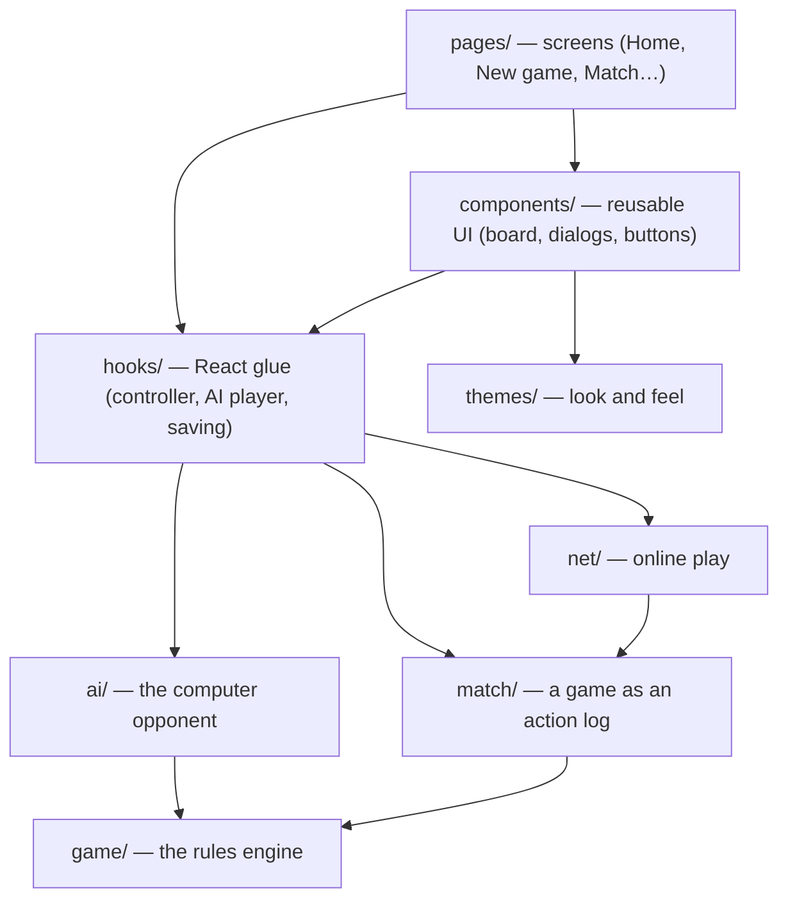
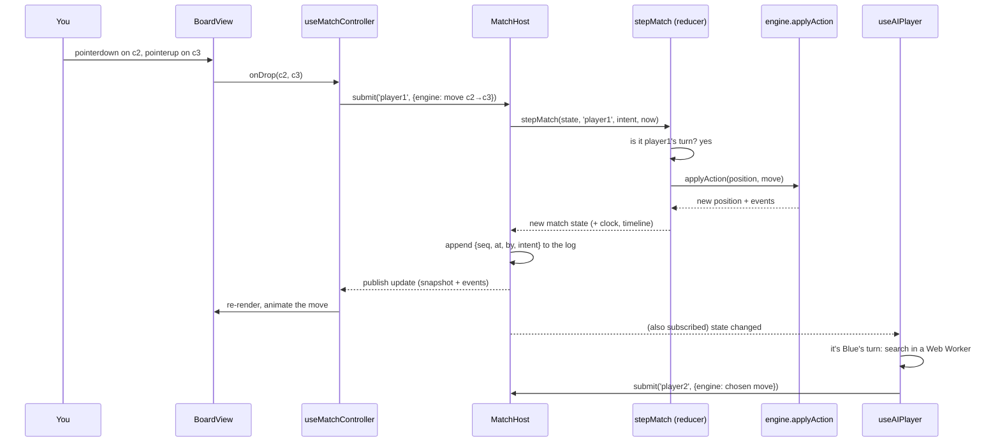

# Open Dam: a guided walkthrough

This document is for the person orchestrating the project. By the end you
should be able to explain what every part of the code does, why it is built
that way, and where to make any change you want. Read it top to bottom once;
afterwards use it as a reference.

**How to read it.** Each part builds on the one before. Part 1 is the big
picture, Part 2 follows one click through the whole system, Parts 3–9 go layer
by layer, Part 10 covers the tools, Part 11 is recipes for common changes, and
Part 12 has exercises to check your understanding. File references look like
`src/game/engine.ts` and are worth opening alongside the text.

---

## Part 1 — The big picture

### What the program is

A website where you can play Dam, the Gambian board game: against the
computer, against someone on the same device, or (in preview) against someone
in another browser tab. It also teaches the rules and has a free "analysis"
board.

### The layers

The code is a stack of layers. Each layer only uses the layers below it. This
is the single most important structural rule in the project.



| Layer   | Folder                        | Knows about React? | Job                                                                 |
| ------- | ----------------------------- | ------------------ | ------------------------------------------------------------------- |
| Rules   | `src/game`                    | No                 | What is legal; what happens after a move                            |
| AI      | `src/ai`                      | No                 | Choose a move for the computer                                      |
| Match   | `src/match`                   | No                 | A whole game: who plays, the log of actions, offers, clocks, saving |
| Network | `src/net`                     | No                 | Send a match between browsers                                       |
| Hooks   | `src/hooks`                   | Yes                | Connect the pure layers to React components                         |
| UI      | `src/components`, `src/pages` | Yes                | What you see and click                                              |
| Themes  | `src/themes`, `src/styles`    | Partly             | Colours, shapes, motion                                             |

Why this matters: the bottom four layers are **pure TypeScript**. They can be
tested in milliseconds without a browser, they could run on a server
unchanged, and a bug in the UI cannot corrupt the rules.

### Three ideas that explain most of the design

1. **The engine is a pure function.** `applyAction(state, action)` returns a
   new state plus a list of events. It never changes the old state, never
   touches the screen, never reads the clock. (Part 3.)
2. **A game is a log of actions.** The match layer stores the settings, who sits
   where, and every action in order. The board, the move list, the clocks and
   pending offers are all _computed_ by replaying that log. Saving, undo,
   review and online play all come from this one idea. (Part 5.)
3. **Themes are complete visual languages.** A theme supplies colour tokens and
   its own React components for pieces and board decorations, so a theme can
   change shapes, not only colours. (Part 8.)

---

## Part 2 — The life of a click

Let's follow what happens when you play Red against the computer and drag a
piece from c2 to c3. Keep this trace in mind; every later part zooms into one
step of it.



Step by step:

1. **Input.** `src/components/board/BoardView.tsx` receives the pointer events.
   `src/hooks/usePointerDrag.ts` decides whether it was a tap or a drag and
   which square the pointer was released on.
2. **Permission to touch.** Before a drag can even start, the board asks
   `canDragFrom(c2)`. That comes from `useMatchController` and says yes only if
   it is your turn and c2 holds one of _your_ pieces. This is why you can't move
   the computer's pieces.
3. **Intent.** The controller turns the drop into an _intent_,
   `{ type: 'engine', action: { type: 'move', from, to } }`, and submits it to
   the session as `player1`.
4. **Judgement.** `MatchHost.submit` calls `stepMatch` in
   `src/match/reducer.ts`. It checks it's Red's turn, then calls the engine's
   `applyAction`, which checks the rules (orthogonal, forward or sideways, not
   occupied…). If anything fails you get an error string, shown as a toast.
5. **Record.** The host stamps the intent with a sequence number and the time,
   appends it to the log, and computes the new state: new position, clock
   handed to Blue, offers cleared.
6. **Broadcast.** The host notifies its subscribers. React re-renders through
   `useSyncExternalStore`; the controller feeds the engine's events to the
   animation hook; the saving hook writes the record to localStorage.
7. **The computer's turn.** `src/hooks/useAIPlayer.ts` is also subscribed. It
   sees it is Blue's turn and asks `src/ai/client.ts` to search in a Web
   Worker, so the page doesn't freeze. When the answer arrives it submits it
   through exactly the same `submit` call. The computer is just another
   participant.

---

## Part 3 — The rules engine (`src/game`)

### The vocabulary: `types.ts`

Start here, because every other file speaks this language.

- `PlayerId` is `'player1' | 'player2'`. Player 1 starts at the bottom and moves
  up; player 2 starts at the top and moves down. Themes give them names (Red and
  Blue, Black and White, Coral and Sky).
- `Board` is a 2-D array of `PieceData | null`. Row 0 is the **top**.
- `RuleSettings` is board size, start type, the three house rules (promotion
  during a chain, what a call removes, whether stopping a chain is callable), the
  two draw rules, and an optional time control.
- `EngineState` is a complete position: board, side to move, status, the chain
  in progress, the _offenders_ (pieces that passed up a capture and can be
  called), the move list, repetition counts, and the no-capture counter.
- `EngineAction` is everything a player can do: `move`, `end-chain`, `call`,
  `resign`, `agree-draw`, `timeout`.
- `GameEvent` describes what happened (moved, captured, crowned, called…), so the
  UI can animate without comparing boards.

### The geometry: `board.ts` and `moves.ts`

- `board.ts` fixes the direction convention once (`forwardDir`,
  `promotionRow`), builds starting positions (odd boards interlock around an
  empty centre; even boards start in rows with a two-row gap), and serialises
  positions for repetition detection.
- `moves.ts` generates moves. Normal pieces move one step forward, left or
  right; they capture by jumping an adjacent enemy straight across onto the
  empty square beyond. Kings move any distance and may land anywhere past the
  piece they jump. `classifyMove(board, player, from, to)` is how the engine
  turns "from here to there" into a slide, a capture, or a human-readable reason
  it's illegal.

### The state machine: `engine.ts`

This is the heart. Read it in this order:

1. `createInitialState(settings)` — a fresh game.
2. `applyMove(state, from, to)` — the big one. It handles, in order: the chain
   lock (mid-chain you may only continue with the same piece), the special
   first move on odd boards (any piece may go straight into the centre), slides
   (with promotion), and captures (with the three promotion policies and chain
   continuation).
3. `endTurn(...)` — hands the turn over. This is where **offenders** are
   computed: if you could have captured at the start of your turn and didn't,
   your capturing pieces become callable. It also re-finds each offender on
   the board, because the piece that skipped the capture might be the one that
   just moved.
4. `applyCall(state, pieceId?)` — removes an offender. It does **not** end the
   turn: you call, then still move.
5. `declineChain(state)` — stop a chain early; under the default rules the
   piece becomes callable.
6. `evaluateStatus` / `settleStatus` — checked after every change: no pieces
   left → loss; side to move has no legal move and nothing to call → loss; one
   piece each with nothing to capture → draw; threefold repetition → draw; too
   many moves without a capture → draw.
7. `applyAction(state, action)` — a switch that routes any `EngineAction` to the
   functions above. This is the single entry point everything else uses.
8. `legalActions(state)` — every legal action; the AI and tests use it.

**Why pure functions?** Because `applyMove` returns a _new_ state and never
modifies the old one, keeping history is trivial (just keep the old states),
and every function can be tested by building a position and checking the
result. Look at `src/game/engine.test.ts`: positions are written as text
(`'..a..'`) using `positionFromAscii` from `position.ts`.

### Notation: `notation.ts`

Squares are named like chess: file letter + rank number, with a1 at Red's
bottom-left. Moves: `c2-c3` (quiet), `c2xc4` (capture), `c2xc4xe4` (chain),
`=K` (crowned), ` ?!` (a capture was passed up), `!c3` (a call).
`toMoveRows` groups the flat move list into numbered pairs for display.

### Settings: `settings.ts`

Defaults with the reasoning for each subjective rule, the time controls, the
labels the UI shows, the rules summary for the Learn page, and the matchmaking
compatibility check that online play will use.

---

## Part 4 — The computer opponent (`src/ai`)

### How it chooses a move: `search.ts`

The AI uses **negamax with alpha-beta pruning**, the classic game-tree search:

- Look at every move, then every reply, then every reply to that, down to a
  fixed depth.
- At the bottom, score the position with `evaluate`.
- "Negamax" means a score is always from the point of view of the side to move;
  a child's score is negated when the turn passes to the opponent.
- "Alpha-beta" skips branches that cannot change the final decision, which
  makes deep searches affordable.

Things specific to Dam:

- **Chains don't alternate turns, and cost no depth.** A capture that can
  continue keeps the same player on move, so a child's score is only negated if
  the turn actually changed. Each chain leg is searched at the same depth: a
  chain is one decision, and it always ends because every leg removes a piece.
  Without this, a three-leg chain used up three plies of lookahead and the
  engine could not see a sacrifice that sets one up.
- **Calls are taken greedily.** Calling is free material and doesn't use your
  turn, so the search always takes the most valuable call instead of branching.
- **Skipping a capture is not free.** At the bottom of the search
  (quiescence) it keeps looking at captures until things are quiet. The side to
  move may normally "stand pat" there, but in Dam standing pat while a capture
  is on the board means declining it, and the piece gets called. The search
  charges for that (`declineCost`), which is what lets it see the sacrifice
  that says "take this, or lose that piece".
- **Forced replies are looked at deeper**, like check extensions in chess,
  within a per-line budget.
- **Iterative deepening, a transposition table and move ordering.** It
  searches depth 1, then 2, then 3… until the time budget runs out. Positions
  already scored are remembered by a Zobrist hash (`hash.ts`), and moves that
  caused cut-offs before are tried first.

### How it scores a position: `evaluate.ts`

Material (kings are worth more on bigger boards), mobility, advancement
(scaled by the promotion rule), holding your back row, the cost of being
callable, capture threats, king activity, corrections for drawish endings and
running draw counters, and **lone-king technique**.

Four rules decide almost every ending, and the evaluation has to know them:

1. **A last piece is crowned automatically.** Taking the opponent's
   second-to-last piece gives their last one a free crown, so "winning a king"
   can be an even trade.
2. **One piece each with nothing to capture is a draw.** Winning means total
   elimination, so a one-piece lead at the end is usually not enough.
3. **A lone king that can capture must.** If it declines, its last piece is
   called and it loses. So the hunter can force its move: offer a piece where
   every landing square is covered, and it has to take and be taken (the
   kill-or-be-called sacrifice). `loneKingPressure` counts the lone king's safe
   squares, and when a capture is on offer, only its safe landings.
4. **Men cannot hunt.** They never move backward, and the lone king guards
   their whole crowning row; the only safe crowning squares are ones it cannot
   jump, usually corners. `promotionPush` rewards getting a man there. With a
   king, the technique is to take away the lone king's safe squares, ending
   with it in a corner and kings on the two edges that meet there.

### How tiers differ: `difficulty.ts`

Five opponents, named in Wolof, differ in what they _know_, in the order a
person learns it. The names mean the fool, the child, the youngster
(usually a teen), the elder and the master; the app shows each meaning beside the
name.

| Tier      | What it knows                                                                             |
| --------- | ----------------------------------------------------------------------------------------- |
| **Döff**  | Counts pieces, looks one move ahead, often forgets to call.                               |
| **Khàlé** | Sees your reply, but not that a capture it skips will be called.                          |
| **Ndö**   | Knows the calling rule cold; reads short exchanges. No deep sacrifices, no endgame plan.  |
| **Màam**  | Deep search, every chain, sacrifices that win kings, lone-king hunting. Rare small slips. |
| **Seriñ** | Everything, deepest, forced-reply extensions, full technique, no deliberate errors.       |

The weaker tiers make "near miss" mistakes: when they slip, they pick a move
that scored almost as well, the way a person misjudges rather than throws a
piece away. Old tier ids (`novice`, `club`, `expert`, `master`) in saved games
and links map to their successors through `normalizeDifficultyId`.

### Other decisions: `opponent.ts`

Whether to accept an undo (compares the evaluation now against the position the
undo would return to) or a draw (accepts when not clearly ahead).

### Off the main thread: `client.ts` and `search.worker.ts`

The search can take a couple of seconds. Running it on the page's main thread
would freeze clicks and animations, so `searchAsync` sends the position to a
Web Worker (a background thread) and waits for the answer. If workers aren't
available it falls back to running inline.

### Two bugs worth understanding

**Whose score is this?** The old Master once drew Novice six games out of six.
When the search reached a finished game it scored it from the _root player's_
point of view instead of the side to move, so a winning capture that handed the
turn over came back with the wrong sign. Always ask who a negamax score is for.

**Credit, not blame.** The first lone-king term scored the hunter _down_ for
every square the lone king could still reach. Reducing the opponent to one
piece then looked worse than leaving them two, so the engine stopped taking
winning captures and lost twelve games out of twelve to the old engine. It was
found by switching each new feature off in turn. A replayed game then showed a
second mistake: the engine sacrificed a man to win a king without realising the
opponent's last man would be crowned for free, and reached a dead draw with two
men against a king. The term now only adds credit for progress, and only counts
in full when the hunter has a king.

To study a game yourself, `RED=serin BLUE=maam SEED=3 FROM=6 npm run replay`
prints every ply with the board and the engine's score. Find the move where the
score went wrong, then ask which rule the evaluation did not understand.

---

## Part 5 — A game as a log (`src/match`)

### The record

```ts
MatchRecord = {
  format: 'open-dam/match', version: 1,
  config: { id, mode: 'local' | 'online', settings, seats, createdAt },
  actions: [ { seq: 1, at: 1730073600000, by: 'player1', intent: {...} }, ... ]
}
```

`seats` says who plays each side: `human` (this device), `ai` (with a
difficulty), or `remote` (someone elsewhere).

An **intent** is what someone asks for: a board action, an offer (undo or
draw), an answer to an offer, withdrawing an offer, or clock bookkeeping (pause
and resume). An **action** is an intent that was accepted, stamped with its
sequence number, time, and who made it.

### The reducer: `reducer.ts`

`stepMatch(state, by, intent, at)` is the judge. Given the current match state,
who is asking, what they ask, and when, it either refuses with a reason or
returns the next state. It enforces:

- only the side to move can make board moves; you can only resign for yourself;
- only the clock (`system`) can call time, and only when time is really up;
- one undo request and one draw offer per player per turn;
- only the other player can answer an offer; only the offerer can withdraw it;
- playing on declines a pending offer;
- an accepted undo rolls `timeline` back to the requester's last turn.

`replay(record)` runs every action through `stepMatch` from the start. If any
action is refused, the record is invalid and replay throws, which is how
corrupted saves are detected.

`MatchState.timeline` holds every position since the start, which is what makes
reviewing any move possible.

### Clocks: `match/clock.ts`

The clock is never a running timer inside the game. It is arithmetic on action
timestamps: when a turn finishes at time `at`, the mover is charged
`at − since`, gets the increment, and the opponent starts running from `at`.
To show the time "now", `remainingAt(clock, player, now)` subtracts the time
since `since` for the running side. Because everything comes from timestamps
in the log, replaying a saved game reproduces the clocks exactly.

Pause and resume exist for local games: when you close the app, the clock
shouldn't keep eating your time, so the saving hook records a pause, and a
resume when you come back.

### Sessions: `session.ts`

A session wraps a record and its state so React can watch it:
`getSnapshot()`, `subscribe(listener)`, `submit(by, intent)`. `MatchHost`
is the authoritative kind: it runs `stepMatch`, stamps actions, appends them,
and publishes. Every local game is a `MatchHost`.

### Saving: `storage.ts` and `setup.ts`

- `saveActiveMatch` / `loadActiveMatch` keep the one unfinished game in
  localStorage. Loading **validates** the shape and replays it; anything that
  doesn't replay is discarded rather than trusted.
- `archiveMatch` keeps the last 20 finished games for "Recent games" and review.
- `setup.ts` describes the New Game form's result and its URL form, so the
  Home page's quick-play cards are plain links like
  `/match/new?vs=club&size=5`.

---

## Part 6 — Online play (`src/net`)

Read `docs/MULTIPLAYER.md` for the full design. In short:

- One device is the **host** (today, the tab that created the game; later, a
  server). It owns the log and runs the reducer.
- Other devices are **guests** (`MatchGuest`). They send intents and apply the
  actions the host broadcasts. They never decide anything themselves, so two
  devices can never disagree about the game.
- `protocol.ts` lists the messages; `transport.ts` moves them. Today the
  transport is a `BroadcastChannel`, which only reaches tabs in the same
  browser. A WebSocket transport to a server is the next step, and nothing
  above the transport needs to change.
- `hostLink.ts` is the host-side "server logic": binding a browser tab to a
  seat, forwarding its intents to the reducer, broadcasting accepted actions,
  and tracking who is online through heartbeats.

---

## Part 7 — React glue (`src/hooks`)

Hooks are where pure logic meets React's rendering.

- **`useMatchSession`** subscribes a component to a session with
  `useSyncExternalStore`, React's built-in way to read an external store, so
  the screen always shows the session's current snapshot. It also passes every
  update (with events and notices) to a callback, for side effects.
- **`useMatchController`** is the brain of the match screen. Given a session
  and which sides this device plays, it works out what to draw (the live
  position or one being reviewed), which squares are clickable, the legal
  destinations of the selected piece, which pieces can be called, and provides
  the actions (`onSquare`, `onDrop`, `call`, `endChain`, `resign`, `offer`,
  `answerOffer`, `goTo` for review). It also turns notices into toasts and
  announcements, and, on the authoritative device, submits a timeout exactly
  when a clock runs out.
- **`useAIPlayer`** plays a seat for the computer (Part 2, step 7).
- **`useMatchPersistence`** saves after every action, archives finished
  games, and pauses or resumes the clock when you leave or return.
- **`useBoardAnimations`** turns engine events into short-lived animation
  entries (a piece travelling, a captured piece shrinking away, a crowning).
- **`usePointerDrag`** handles tap-or-drag for mouse, touch and pen.
- **`useNow`** provides a ticking "now" only while a clock is running.
- **`useAnalysisBoard`** is the analysis page's own small state machine: edit
  squares, play either side, undo and redo.

A React note: components in this project use the **React Compiler** (set up in
`vite.config.ts`), which memoises automatically. The lint rules from
`eslint-plugin-react-hooks` enforce the patterns it needs, such as not reading
refs during render and not setting state synchronously inside effects.

---

## Part 8 — Themes and styling

### Tokens

Every colour, border, radius, shadow and font is a CSS custom property named
`--dam-…`, listed in `src/themes/types.ts` (`ThemeTokens`). Each theme's
`theme.ts` gives them values. `src/context/ThemeContext.tsx` writes them onto
the `<html>` element and sets `data-theme="<key>"`.

### Two layers of CSS

- `src/styles/app.css` lays out every component **using tokens only**. It never
  names a colour. Change a token and every component follows.
- `src/themes/<theme>/theme.css` adds that theme's signature, scoped to
  `[data-theme='<theme>']`: hard offset shadows and pressing buttons in
  Neobrutalist, hairlines and spaced capitals in Atelier, pill buttons and
  separated tiles in Carnival.

### Parts

Some differences can't be done with CSS alone, so a theme also provides React
components (`parts.tsx`): `Piece` (a flat disc, an open ring, or a painted
festival token), `CellDecor` (how legal moves are marked), `BoardFrame`,
and `EndSequence` (the end-of-game animation on the board).

### Side names

Each theme names the sides (`sides` in `theme.ts`). Atelier's pieces are black
and white, so "Red" and "Blue" would be wrong there. Text comes from
`useSideNames()`. In every theme, the two sides also differ in **shape**, not
only colour, so they can be told apart without colour vision.

### Accessibility in the styling

`src/styles/base.css` sets one visible focus ring for everything, a skip link,
a `visually-hidden` utility for screen-reader-only text, and turns off CSS
animation when the system asks for reduced motion. framer-motion animations
honour the same setting through `<MotionConfig reducedMotion="user">` in
`src/App.tsx`.

---

## Part 9 — The screens (`src/pages`, `src/components`)

| Route                  | Page               | Notes                                                                                                   |
| ---------------------- | ------------------ | ------------------------------------------------------------------------------------------------------- |
| `/`                    | `HomePage`         | Live demo game; Continue card; quick play with board previews; recent games.                            |
| `/play`                | `NewGamePage`      | Opponent cards, your side, rules; house rules as a summary with an edit dialog. Asks before discarding. |
| `/match/new?…`         | `NewMatchFromLink` | Builds a game from a link, then redirects to `/match/:id`.                                              |
| `/match/:id`           | `MatchPage`        | Loads the saved game (keyed by id, so a rematch remounts); hosts it; attaches the AI and saving.        |
| `/online/:id`          | `OnlinePage`       | Hosts (creator tab) or joins (`?seat=`).                                                                |
| `/review/:id`          | `ReviewPage`       | A finished game, read-only, steppable.                                                                  |
| `/learn`, `/learn/:id` | `TutorialPage`     | Rules at a glance, eight chapters with example boards.                                                  |
| `/analysis`            | `AnalysisPage`     | Set up and explore positions, with a move list for the line you play.                                   |
| `/leaderboards`        | `LeaderboardsPage` | Sample data until there is a server.                                                                    |

The match screen (`components/game/MatchScreen.tsx`) is composed of:
`PlayerCard` ×2 (name, pieces, turn, clock, Undo/Draw/Resign), `BoardView`,
`StatusPanel` (what's happening and the decisions you can make), `MoveList`
(notation and review), a resign `ConfirmDialog`, and a `ResultDialog`.

**The board and accessibility.** `BoardView` is an ARIA grid: one Tab stop,
arrow keys move between squares, Enter or Space acts, Escape clears the
selection. Each square has a spoken label such as "c3, Red piece, selected,
can be called". After each move, a hidden live region announces it, for
example "Blue: c4 jumps to c2, capturing".

**Dialogs** (`components/ui/Dialog.tsx`) move focus inside when they open, keep
Tab inside, close on Escape or a backdrop click, and return focus to whatever
opened them.

**Tutorial examples** (`pages/tutorial`) are scripts of real actions replayed
through the engine, so an example can never show an illegal move. A test
replays every example.

---

## Part 10 — Tools and tests

| Command                  | What it runs                              |
| ------------------------ | ----------------------------------------- |
| `npm run dev`            | Vite dev server with hot reload           |
| `npm test`               | Vitest: ~160 tests in a few seconds       |
| `npm run typecheck`      | TypeScript in strict mode                 |
| `npm run lint`           | ESLint                                    |
| `npm run format`         | Prettier                                  |
| `npm run verify`         | All of the above, then a production build |
| `npm run check:ai`       | Tier-vs-tier matches (several minutes)    |
| `npm run check:endgames` | Endgame conversion from random starts     |
| `npm run replay`         | Print one computer game ply by ply        |

Where the tests are and what they protect:

| File                                  | Protects                                                                                                         |
| ------------------------------------- | ---------------------------------------------------------------------------------------------------------------- |
| `src/game/engine.test.ts`             | Every rule branch                                                                                                |
| `src/ai/ai.test.ts`                   | Legal play for every tier, sacrifices, lone-king finishes, missed calls, time budget, offers                     |
| `src/match/match.test.ts`             | Turn ownership, offers, undo, clocks, replay, saving                                                             |
| `src/net/net.test.ts`                 | Joining, syncing both ways, refusals, seat ownership, reconnecting                                               |
| `src/pages/tutorial/tutorial.test.ts` | Every tutorial example is legal                                                                                  |
| `src/lib/describe.test.ts`            | Wording and URL setup round trips                                                                                |
| `src/test/ui.test.tsx`                | The real screens: keyboard board and Tab stops, AI pieces, resign, rematch, house rules, analysis moves, dialogs |
| `scripts/ai-strength.test.ts`         | Stronger tiers beat weaker ones (slow, separate)                                                                 |

CI (`.github/workflows/ci.yml`) runs `verify` on every push and pull request.

---

## Part 11 — Recipes

**Change a rule.** Edit `src/game/engine.ts` (or `moves.ts`). Add a test in
`engine.test.ts` with a text position. Update `RULES_AT_A_GLANCE` in
`settings.ts` and the matching tutorial chapter in
`pages/tutorial/chapters.ts`. Run `npm run check:ai` to see how the AI copes.

**Make a rule optional.** Add a field to `RuleSettings` (`types.ts`) with a
default in `DEFAULT_SETTINGS`, read it in the engine, add a control in
`components/settings/RulesForm.tsx`, add it to `setupToParams`/`setupFromParams`
in `match/setup.ts`, and to `settingsAreCompatible`.

**Add a theme.** Copy a theme folder, rename the key, give it tokens, parts,
side names and a `theme.css` scoped to `[data-theme='<key>']`. Add it to
`ThemeKey` in `themes/types.ts` and to `THEMES` in `themes/registry.ts`. Check
every screen in it.

**Add an AI tier.** Add an entry to `DIFFICULTIES` in `ai/difficulty.ts` and
its id to `DIFFICULTY_IDS`. It appears on New game and Home automatically.
Add it to the matches in `scripts/ai-strength.test.ts`. If you rename one, map the
old id in `normalizeDifficultyId` so saved games and links keep working.

**Add a page.** Create it in `src/pages`, wrap it in `AppShell`, call
`usePageTitle`, add a `<Route>` in `AppRoutes` (`src/App.tsx`, lazily if it's
rarely visited), and a nav entry in `components/layout/navItems.ts` if it
belongs in the menu.

**Add a sentence the game says.** Put it in `src/lib/describe.ts`, so all
screens and announcements stay consistent.

**Add an online server.** Follow "Adding a real server" in
`docs/MULTIPLAYER.md`.

---

## Part 12 — Check your understanding

Try answering these before looking. Answers follow.

1. Why can't you move the computer's pieces?
2. Where would you change what a call removes?
3. You reload in the middle of a timed game. Why doesn't your clock reset?
4. Why does the AI run in a Web Worker?
5. A guest tab misses one network message. What happens?
6. Why does Atelier say "Black" and "White"?
7. Where would a rule bug be caught first?

**Answers.**

1. `useMatchController` only allows input when it's a _local_ seat's turn
   (`canAct`, `canDragFrom`), and even if a click got through, the reducer's
   `stepMatch` refuses a move whose `by` isn't the side to move.
2. In the engine, `applyCall` in `src/game/engine.ts`, driven by
   `settings.call.scope`.
3. Because the clock is computed from timestamped actions in the saved
   record, plus a pause when you left and a resume when you came back
   (`useMatchPersistence`, `resumeAfterGap`).
4. So the page stays responsive while it thinks; the search can take over a
   second.
5. It notices a gap in sequence numbers, sends `join` again, and the host
   replies with a full `welcome` snapshot (`MatchGuest.handle`).
6. Its pieces are black and white; each theme names its own sides in
   `theme.ts`, and text reads them through `useSideNames()`.
7. In `src/game/engine.test.ts`, which tests every rule branch with small text
   positions; then by the tutorial test, whose examples replay real moves.

---

## Glossary

- **Action / intent** — An intent is what someone asks for; an action is an
  accepted intent with a sequence number, time and author.
- **Alpha-beta** — Skipping search branches that can't change the decision.
- **Call** — Removing an opponent's piece that passed up a capture.
- **Chain** — Several captures by one piece in one turn.
- **Event** — A description of what changed (moved, captured, crowned), used
  for animation.
- **Host / guest** — The device that owns the game log / a device that mirrors it.
- **Negamax** — Game-tree search where scores are always from the side to
  move's point of view.
- **Offender** — A piece that could have captured and didn't; it can be called.
- **Ply** — One player's move (a "move" in chess terms is two plies).
- **Pure function** — Returns a result based only on its inputs, with no side
  effects.
- **Reducer** — A function `(state, action) → state`.
- **Replay** — Rebuilding a game's state by applying its log from the start.
- **Session** — The live, observable form of a match that React watches.
- **Token** — A named design value (a CSS custom property) that themes set.
- **Transport** — The thing that carries network messages (BroadcastChannel
  today, WebSocket later).
